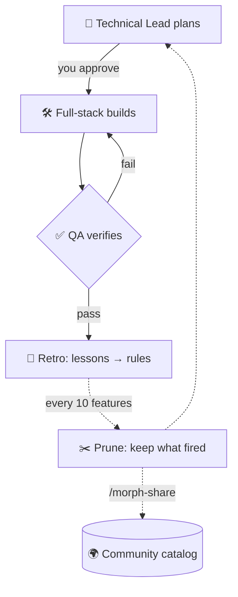
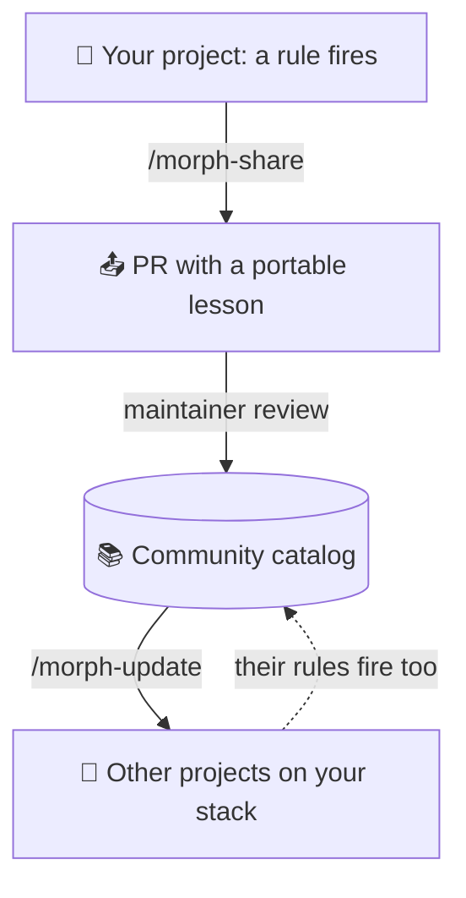

<div align="center">


# Morphness

**A self-improving agent harness for Claude Code**

🧭 **Plan** → 🛠️ **Build** → ✅ **QA** → 🔁 **Retro** → ✂️ **Prune** → 🌍 **Share**

A ready-made AI coding workflow that starts generic, morphs into your project's own,<br>
and gets better every time someone shares a lesson.

💜 **From the community, for the community** 💜

[](LICENSE)
[](#-install)
[](#-what-you-get)
[](lessons/)
[](https://github.com/antarsoft/morphness/stargazers)
[](CONTRIBUTING.md)

🌐 [Website](https://antarsoft.github.io/morphness) · 🚀 [Install](#-install) · ✨ [Why](#-why-use-it) · 🧠 [How it works](#-how-it-works) · 📦 [What you get](#-what-you-get) · 🧰 [Make it yours](#-make-it-yours) · 🦋 [How it morphs](#-how-it-morphs) · 🌍 [Community](#-community-lessons) · 🤝 [Contributing](CONTRIBUTING.md)

</div>

---

**Morphness** is an open-source, multi-agent harness for [Claude Code](https://claude.com/claude-code):
a set of subagents, `CLAUDE.md` / `AGENTS.md` rules, checklists and a review loop for AI coding
agents. If you have been writing those by hand (what people now call *harness engineering* or
*context engineering*), Morphness is that work packaged, with a loop that keeps it current.

You talk to a **Technical Lead** in the main chat. It plans each feature with testable acceptance
criteria and waits for your approval, then hands the work to a **Full-stack** agent and a mandatory
**QA** agent. After every feature, a short retrospective turns what went wrong into rules. After
every ten, a prune audits those rules: the ones that caught problems stay, and the ones that never
fire get questioned, then moved out of the rules every session loads.

The harness you have after fifty features is shaped by your project, your stack and how you work.
Rules that prove themselves can also leave your repo as **community lessons**, so the next team on
your stack starts with them.

> [!NOTE]
> Morphness was built and run for about 150 features on a real product,
> [Twinpage](https://twinpage.app). Its starting checklist and its first lessons come from problems
> that actually happened there.

## ✨ Why use it

| Reason | What that means |
|--------|-----------------|
| 🌍 **Improved by the community** | Every lesson in the catalog comes from a rule that ran in a real project, with its evidence recorded. `/morph-update` offers the ones that match your stack; `/morph-share` sends yours back. |
| 🧭 **Plan first, then build** | A Technical Lead writes a plan with testable acceptance criteria and waits for your approval before any code is written. |
| ✅ **QA is never skipped** | Every feature gets a separate QA agent that runs your checks and records the evidence, so "done" means verified, not claimed. |
| 🔁 **Learns from its own mistakes** | Retros turn failures into rules, and prunes delete rules that never fire, so the instructions your agents read stay short and earned. |
| 🛡️ **Safe by default** | Secrets and pushes to protected branches are denied in `.claude/settings.json` from the first install; with the data-access module, your database and hosting write tools are denied too. Every agent also reads the rule: never write to a shared remote environment. |
| 🧰 **Yours to configure** | Branches, checks, modules, risk areas, models, effort and loop limits all live in one `harness.config.yml`. Every rule and checklist is a plain Markdown file in your repo, so you can change anything. |
| 🧩 **Works on any codebase** | New or existing repos, including ones that already have a `CLAUDE.md`, `AGENTS.md` or their own agent setup. Any language or framework. |

## 🚀 Install

**🤖 Ask your agent.** Copy this into any Claude Code session inside your repo. It works for a new
or an existing project:

```text
Set up the Morphness agent harness in this repo by following
https://github.com/antarsoft/morphness/blob/main/INSTALL.md step by step.
Scan the repo first, then ask me the setup questions one at a time with your suggested answer.
Keep my existing files, install skills or connectors only after I say yes, and put every change
on a new branch for me to review.
If Morphness is already installed here, follow its UPDATE.md instead and show me what changed upstream.
```

**🔌 Or as a plugin:**

```text
/plugin marketplace add antarsoft/morphness
/plugin install morphness@morphness
/morph-init
```

<details>
<summary><b>🛠️ Or by hand</b></summary>

```bash
git clone --depth 1 https://github.com/antarsoft/morphness /tmp/morphness
/tmp/morphness/scripts/install.sh /path/to/your/repo   # copies, never overwrites
# then, in Claude Code inside your repo, paste:
#   Follow /tmp/morphness/skills/morph-init/SKILL.md to set up the harness here
# (or install the plugin above and run /morph-init)
```

</details>

The setup (`/morph-init`, or your agent following `INSTALL.md`) works for new and ongoing
projects. On an ongoing one, it scans the repo first and suggests answers. Then it asks a short series of questions, one at a time, each with a suggested
answer: what you're building, who approves, where you run Claude, your stack, the commands behind
each check, branches, and which optional modules you want. You can also point it at a brief or fill
in an answers file instead.

It suggests skills, connectors and community lessons that fit your stack, and installs only the ones
you accept. Existing files such as your `CLAUDE.md` are kept, settings are merged with the diff
shown, and everything lands on a branch for you to review.

<details>
<summary><b>📋 Requirements and cost</b></summary>

- **Claude Code** with plugins, subagents (the Agent tool) and effort levels.
- **Models:** opus and sonnet. The legal writer prefers fable and falls back to opus.
- **Tools:** git and bash. `gh` for `/morph-share` to open its PR.
- **Cost:** each feature is about three agent runs (plan, build, QA) plus a short retro, with the
  Technical Lead and Full-stack on opus at high effort by default. Tune spend with the medium
  variants and `project/HARNESS_AGENTS.md` § Effort per feature.

</details>

### Your first feature

1. Ask the Technical Lead: `plan <feature>`.
2. Read the plan and its acceptance criteria, then approve it.
3. It delegates the build to Full-stack, then QA checks every criterion.
4. You get a steps file (anything only you can do) and a short retro.

> [!TIP]
> ⭐ If Morphness saves you a rework round, [star the repo](https://github.com/antarsoft/morphness) so more teams find it.

## 🧠 How it works



| Role | What it does | Model · effort |
|------|--------------|----------------|
| 🧭 **Technical Lead** | Your session. Plans, delegates, never codes | opus · high |
| 🛠️ **Full-stack** | Builds the approved plan and its tests | opus · high (xhigh for risky cores; sonnet · medium for pattern-copy work) |
| ✅ **QA** | Runs the checks, validates every criterion | sonnet · high (medium for small work) |
| 🔎 **Researcher** | Answers a question about your code or the web with cited sources, read-only. For when you want an answer, not a change | sonnet · medium (opus · high for architecture) |
| ⚖️ **Legal writer** | Writes wording that makes a legal promise | fable or opus · high |

These are defaults; change any of them (see [Make it yours](#-make-it-yours)).

| Skill | Use |
|-------|-----|
| `/morph-init` | Install and set up the harness. |
| `/morph-update` | Review what changed upstream (kit updates and lessons) and bring in what you accept, merged with your edits. |
| `/morph-doctor` | Check wiring, flag a due prune or stuck features, and count upstream updates waiting. |
| `/morph-share` | Turn rules that fired into a PR to the lessons catalog. |

Morphness runs in plain Claude Code (CLI, desktop, web). If you use a **Claude Project** with a
coordinator and threads, the `claude-projects` module adds a playbook for the Project instructions
and advised settings (coordinator opus · medium, feature threads opus · high).

## 📦 What you get

| Piece | What it does |
|-------|--------------|
| 📄 `AGENTS.md`, `CLAUDE.md`, `.claude/rules/` | The rules every session loads: the Technical Lead plans and delegates and never codes; QA is never skipped. |
| 🤖 `.claude/agents/` | Full-stack (medium, high, xhigh effort), QA (medium, high), researcher (medium, high) and legal-writer subagents. |
| 🗺️ `harness/` | The process: lifecycle, handoffs, checks, modes (full, light, research), release, the plan checklist, and how it morphs. |
| 🧩 `harness/modules/` | Optional: Claude Projects, data access (local-first, remote read-only), browser e2e, legal wording, roadmap, CI/CD pipelines. |
| 🏷️ `project/` | Your project's facts: stack, the commands behind each check, risk areas, effort per area. |
| 🎛️ `harness.config.yml` | Branches, environments, modules, named checks, CI gate, risk areas, models and effort, loop limits. |
| 🗂️ `_harness/` | Runtime: feature folders, learnings, prunes, releases. |
| 🧬 `profiles/` | Optional starting points for known stacks: detect rules, check commands, permissions and matching lessons. The first one is Next.js + Supabase. |

## 🧰 Make it yours

`/morph-init` writes your answers into `harness.config.yml`, and you can edit it by hand any time.
Run `/morph-doctor` afterwards to check the wiring. An abridged example:

```yaml
branches:
  integration: dev          # feature branches start here and PRs target it
  production: main          # moves only through a release

environments:               # in the order code moves through them; add staging, or keep one
  - { name: dev, branch: dev, deploy: host, real_data: false }
  - { name: production, branch: main, deploy: host, real_data: true }

modules: [roadmap, data-access, browser-e2e]

checks:                     # commands for each name live in project/CONTROLS.md
  before_qa: [install, typecheck, lint, unit, build]
  before_signoff: [install, typecheck, lint, unit, build, e2e-full]

ci_gate: false              # true: CI on the PR is the gate; false: the QA record is
risk_areas: [auth, billing, migrations]   # never medium effort, always a careful plan

agents:
  fullstack: { model: opus, medium_model: sonnet, default: high, variants: [medium, high, xhigh] }
  qa: { model: sonnet, default: high, variants: [medium, high] }

loop:
  retro_max_items: 3        # usual action items per retro (soft limit)
  prune_every: 10           # features between prunes
  qa_max_rounds: 2          # QA rework rounds before asking you
```

Beyond the config, everything is a file in your repo that you own:

| To change | Edit |
|-----------|------|
| Check commands, stack facts, test locations | `project/CONTROLS.md`, `project/STACK.md`, `project/TESTING.md` |
| Your own plan checklist items | `project/PLAN_CHECKLIST.md` |
| Agent instructions for this project | `project/agents/<role>.md` (added on top of the generic roles) |
| Model and effort per subagent | `.claude/agents/*.md` |
| What agents may never do | `.claude/settings.json` (deny and ask rules) |
| The process itself | `harness/`, through a retro or prune ([MORPHING.md](template/harness/MORPHING.md)) |

## 🦋 How it morphs

Once installed, the harness belongs to your repo, and the loop is what changes it:

1. 🔁 **Retro** after each feature: only the action items its findings call for (usually up to
   three, none is fine), each with why it was raised, which the Technical Lead approves, defers or
   skips.
2. 📝 **Learnings** file per feature.
3. ✂️ **Prune** every ten learnings files. The rule audit sorts rules into *fired*, *never fired*,
   *insurance* and *too new*. Rules that earn nothing get cut, and trials (an effort level, a new
   check, a model) are decided by their KPIs.

See [template/harness/MORPHING.md](template/harness/MORPHING.md).

### 🔄 Staying up to date

Upstream keeps improving too: new modules, sharper process rules, fixes. Nothing upstream ever
overwrites your copy. Instead:

- `/morph-update` lists what changed in Morphness since your copy last synced and fits your project,
  says why each item matters, and applies only what you accept. A file you never edited takes the
  new version; a file you edited gets a merge that keeps your rules, shown before it's written.
- Every prune runs the same check read-only, so a harness that falls behind gets noticed.
- No plugin? Tell your agent: *"Follow https://github.com/antarsoft/morphness/blob/main/UPDATE.md"*.

Each kit change ships with a short note in [`updates/`](updates/), and releases are dated
([CHANGELOG.md](CHANGELOG.md)).

## 🌍 Community lessons

> 💜 **From the community, for the community.** Your harness learns from your project. The catalog
> learns from everyone's.

Each Morphness project runs its own retro and prune loop. When a prune shows a rule actually
**fired** (it caught a real problem), that rule can leave your repo and help every other team on
a similar stack.

The catalog starts with **112 lessons** from Twinpage, the product Morphness was built on. 83 of
them already ship inside the kit as its default rules; the other 29 are stack- and service-specific
and get offered when they match your project. It grows with every PR, and **yours would be the
second project in it**.



| Catalog | Lessons | Offered on match | What's in it |
|---------|:-------:|:----------------:|--------------|
| 🧠 [`practice/`](lessons/practice) | 68 | 7 | Process rules for any stack: planning, QA, handoffs, agent hygiene |
| 🧱 [`stack/`](lessons/stack) | 24 | 14 | Framework and tool traps: Next.js, Drizzle, Playwright, pnpm, Chromium |
| ☁️ [`service/`](lessons/service) | 20 | 9 | Hosted-service gotchas: Supabase, Vercel, Paddle, GitHub Actions, Claude Code web |

The rest are the kit's built-in rules, kept in the catalog so other projects can add their evidence.

**How to contribute**

1. 📤 **Share.** After a prune, run `/morph-share`. It picks the rules that fired, strips anything
   project-specific, and drafts a PR to [lessons/](lessons/).
2. 🔍 **Review.** A maintainer checks the lesson is new, portable and backed by evidence. Lessons
   are amended, never replaced: your report strengthens an existing lesson when one matches.
3. 📥 **Spread.** Everyone running `/morph-update` sees the new lesson if it matches their stack,
   and picks whether to take it.

A new lesson needs evidence (a `fired` count from a prune audit) to get in. See [CONTRIBUTING.md](CONTRIBUTING.md) and [lessons/README.md](lessons/README.md).

## 🏗️ Built with Morphness

Products and projects that run on a Morphness harness. Add yours with a one-row PR (see
[CONTRIBUTING.md](CONTRIBUTING.md) § Showcase).

| Project | What it is | Stack | By |
|---------|------------|-------|----|
| [**Twinpage**](https://twinpage.app) | Split testing for websites, where Morphness started | Next.js, Supabase | [@ziadantar90](https://github.com/ziadantar90) |

---

<div align="center">

**💜 Like it? Share it**

[](https://x.com/intent/post?text=Morphness%3A%20a%20self-improving%20agent%20harness%20for%20Claude%20Code&url=https%3A%2F%2Fgithub.com%2Fantarsoft%2Fmorphness)
[](https://www.linkedin.com/sharing/share-offsite/?url=https%3A%2F%2Fgithub.com%2Fantarsoft%2Fmorphness)
[](https://www.reddit.com/submit?url=https%3A%2F%2Fgithub.com%2Fantarsoft%2Fmorphness&title=Morphness%3A%20a%20self-improving%20agent%20harness%20for%20Claude%20Code)
[](https://news.ycombinator.com/submitlink?u=https%3A%2F%2Fgithub.com%2Fantarsoft%2Fmorphness&t=Morphness%3A%20a%20self-improving%20agent%20harness%20for%20Claude%20Code)

⭐ [Star the repo](https://github.com/antarsoft/morphness) · 🐛 [Report an issue](https://github.com/antarsoft/morphness/issues) · 🤝 [Contribute a lesson](CONTRIBUTING.md)

<sub>Released under the [MIT License](LICENSE) · [Changelog](CHANGELOG.md) · [Code of Conduct](CODE_OF_CONDUCT.md) · [Security](SECURITY.md). Built by [Antarsoft](https://github.com/antarsoft).</sub>

</div>
