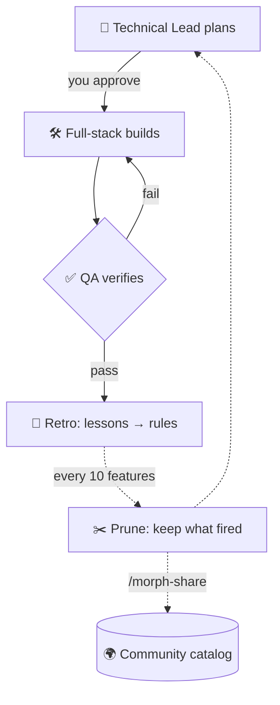
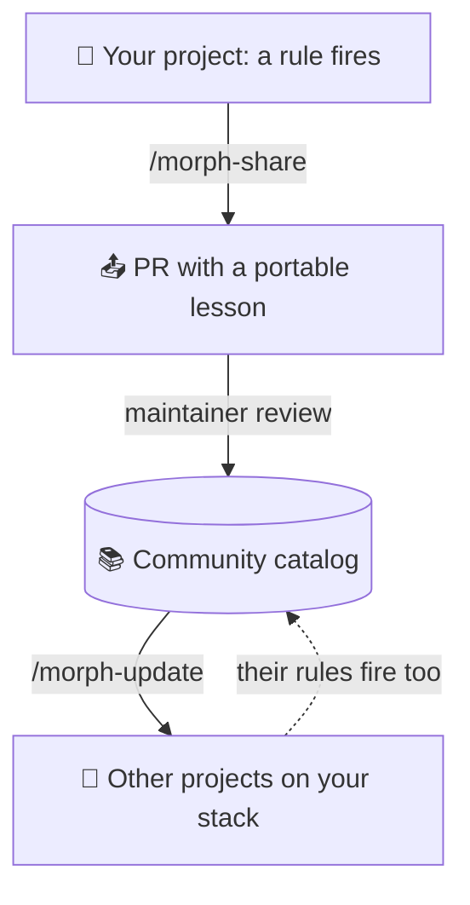

<div align="center">


# Morphness

**The process and safety layer around Claude Code**

🧭 **Plan** → 🛠️ **Build** → ✅ **QA** → 🔁 **Retro** → ✂️ **Prune** → 🌍 **Share**

A self-improving agent harness: it starts generic, morphs into your project's own,<br>
and gets better every time someone shares a lesson.

💜 **From the community, for the community** 💜

[](https://antarsoft.github.io/morphness/trust.html)
[](LICENSE)
[](#-install)
[](#-what-you-get)
[](lessons/)
[](https://github.com/antarsoft/morphness/stargazers)
[](CONTRIBUTING.md)
[](https://discord.gg/zcZTAQq)

🌐 [Website](https://antarsoft.github.io/morphness) · 🚀 [Install](#-install) · ✨ [Why](#-why-use-it) · 🧠 [How it works](#-how-it-works) · 📦 [What you get](#-what-you-get) · 🧰 [Make it yours](#-make-it-yours) · 🦋 [How it morphs](#-how-it-morphs) · 🌍 [Community](#-community-lessons) · 🤝 [Contributing](CONTRIBUTING.md) ·  [Discord](https://discord.gg/zcZTAQq)

</div>

---

**Morphness** is an open-source harness for [Claude Code](https://claude.com/claude-code) that puts
a process around the model: a plan you approve, a separate QA check with recorded evidence, a guard
on risky commands, and a retro loop that turns misses into rules. It is a set of subagents,
`CLAUDE.md` / `AGENTS.md` rules, checklists and a review loop for AI coding agents. If you have been writing those by hand (what people now call *harness engineering* or
*context engineering*), Morphness is that work packaged, with a loop that keeps it current.

Every release is tested, and the results are public, including the known limits: [see the latest run](https://antarsoft.github.io/morphness/trust.html).

You talk to a **Technical Lead** in the main chat. It plans each feature with testable acceptance
criteria and waits for your approval, then hands the work to a **Full-stack** agent and a mandatory
**QA** agent. After every feature, a short retrospective turns what went wrong into rules. After
every ten, a prune audits those rules: the ones that caught problems stay, and the ones that never
fire get questioned, then moved out of the rules every session loads.

The harness you have after fifty features is shaped by your project, your stack and how you work.
Rules that prove themselves can also leave your repo as **community lessons**, so the next team on
your stack starts with them.

> [!NOTE]
> Morphness was built and run for about 150 features on a real product,
> [Twinpage](https://twinpage.app). Its starting checklist and its first lessons come from problems
> that actually happened there.

## ✨ Why use it

Morphness doesn't make the model smarter: a capable model in a plain session already gets most
changes right. What it adds is process around the model: a plan you approve, a QA record with
evidence, an audit trail per feature, rules drawn from your project's own misses, and a lean path
for clear requests so that process costs little when there's nothing to plan.

| Reason | What that means |
|--------|-----------------|
| 🌍 **Improved by the community** | Every lesson in the catalog comes from a rule that ran in a real project, with its evidence recorded. `/morph-update` offers the ones that match your stack; `/morph-share` sends yours back. |
| 🧭 **Plan first, then build** | A Technical Lead writes a plan with testable acceptance criteria and waits for your approval before any code is written. |
| ✅ **QA is never skipped** | Every feature gets a separate QA agent that runs your checks and records the evidence, so "done" means verified, not claimed. |
| 🔁 **Learns from its own mistakes** | Retros turn real misses (a failed QA round, a review fix, a bug you report after a pass) into rules, and prunes delete rules that never fire, so the instructions your agents read stay short and earned. |
| 🛡️ **Safe by default** | A guard hook checks every tool call before it runs. It blocks pushes to environment branches, force-pushes, secret and credential files (`.env*`, keys, cloud credentials), a bare `env`, and remote database writes. It asks you before deploys, publishes, merges, connector writes, unknown downloads and edits to its own files, and blocks everything if it can't run. It stops accidents, not intent, so branch protection and environment secrets on the host stay the real guard. [Exact list](template/AGENTS.md#permissions-for-this-project). |
| 🧪 **Tested as a kit** | Every change to the kit runs a self-test that installs it into sample projects (Next.js with Supabase among them), replays the guard's cases and brings the previous release up to date, so an update doesn't break an install that already works. The [results page](https://antarsoft.github.io/morphness/trust.html) shows the latest run, with public scanners and the known limits. |
| 💲 **Know what each feature costs** | Every feature records an estimated dollar cost from Claude Code's own transcripts, split by agent, so you can compare features and tune effort. Useful as an estimate on a Pro or Max plan too. |
| 🧰 **Yours to configure** | Branches, environments, checks, modules, risk areas, models, effort and loop limits all live in one `harness.config.yml`. Every rule and checklist is a plain Markdown file in your repo, so you can change anything. |
| 🧩 **Works on any codebase** | New or existing repos, including ones that already have a `CLAUDE.md`, `AGENTS.md` or their own agent setup, monorepos with several apps, and folders that aren't a git repo or online yet. Any language or framework. |

## 🚀 Install

**🤖 Ask your agent.** Copy this into any Claude Code session inside your repo. It works for a new
or an existing project:

```text
Set up the Morphness agent harness in this repo by following
https://github.com/antarsoft/morphness/blob/main/INSTALL.md step by step.
Scan the repo first, then ask me the setup questions one at a time with your suggested answer.
Keep my existing files, install skills or connectors only after I say yes, and put every change
on a new branch for me to review.
If Morphness is already installed here, follow its UPDATE.md instead and show me what changed upstream.
```

**🔌 Or as a plugin:**

```text
/plugin marketplace add antarsoft/morphness
/plugin install morphness@morphness
/morph-init
```

<details>
<summary><b>🛠️ Or by hand</b></summary>

```bash
git clone --depth 1 https://github.com/antarsoft/morphness /tmp/morphness
/tmp/morphness/scripts/install.sh /path/to/your/repo   # copies, never overwrites
# then, in Claude Code inside your repo, paste:
#   Follow /tmp/morphness/skills/morph-init/SKILL.md to set up the harness here
# (or install the plugin above and run /morph-init)
```

</details>

The setup (`/morph-init`, or your agent following `INSTALL.md`) works for new and ongoing
projects. On an ongoing one, it scans the repo first and suggests answers. Then it asks a short
series of questions, one at a time, each with a suggested answer: what you're building, who
approves, where you run Claude, your stack, the commands behind each check, branches and
environments, who merges, and which optional modules you want. It explains each technical term the
first time it comes up, so you don't need to be a developer to answer. You can also point it at a
brief or fill in an answers file instead.

If the folder isn't a git repository yet, the setup starts one, and it can create the GitHub
repository on your yes. With your yes it also applies branch protection on the host, or gives you
the steps to do it yourself.

It suggests skills, connectors and community lessons that fit your stack, and installs only the ones
you accept. Existing files such as your `CLAUDE.md` are kept, settings are merged with the diff
shown, and everything lands on a branch for you to review.

<details>
<summary><b>📋 Requirements and cost</b></summary>

- **Claude Code** with plugins, subagents (the Agent tool) and effort levels.
- **Models:** opus and sonnet. The legal writer prefers fable and falls back to opus.
- **Tools:** bash, git, python3, awk and perl are required: python3 runs the guard hook, the
  prune counter and the cost estimate (without it the guard blocks every tool call), awk reads
  `harness.config.yml` in every script, and perl strips a module's text when you remove it.
  `/morph-doctor` checks all of them. `gh` is optional: `/morph-share` uses it to open its PR, and
  setup uses it to apply branch protection or create the repository (each has a manual fallback).
- **Cost:** each feature is about three agent runs (plan, build, QA), with every role on sonnet by
  default (`/morph-init` offers opus for planning and building). A clear, fully specified request
  runs in small mode: a short plan, medium effort and no retro. Every hand-off ends with a
  `Cost ≈ $…` line priced at public API rates (`harness/MODEL_PRICES.md`, editable for your own).
  Tune spend with the medium variants and `project/HARNESS_AGENTS.md` § Effort per feature.

</details>

### What setup leaves in your repo

On a new branch: `harness.config.yml` with your answers, `AGENTS.md`, `CLAUDE.md` and `.claude/`
(rules, agents, guard settings), the `harness/` process docs, a `project/` folder with your stack
and check commands, and `scripts/`. Nothing is overwritten, and you review it as a normal PR.

### Your first feature

1. Ask the Technical Lead: `plan <feature>`.
2. Read the plan and its acceptance criteria, then approve it.
3. It opens a draft PR and delegates the build to Full-stack. QA checks every criterion, and the
   PR is marked ready once it passes.
4. You merge (or let the Technical Lead merge into the integration branch, with `merge_by_agent`).
   You also get a short retro, the feature's cost, and a steps file for anything only you can do.
   When a connected service's official connector can do a step, the Technical Lead offers to do it
   instead, and runs each action only after your yes.

For a small change, ask for **light mode** (no feature folder or retro). For something broken, the
Technical Lead uses **bug mode**: QA writes a failing test first, then Full-stack finds the cause and
makes the smallest fix. When you want an answer rather than a change, ask a question and the
Technical Lead uses **research mode**.

> [!NOTE]
> **What it isn't.** Not a sandbox: the guard stops accidents, not a determined script. It doesn't
> make the model smarter. It adds process, and process costs tokens (about three agent runs per
> feature), so clear small requests use a lean path.

> [!TIP]
> ⭐ If Morphness saves you a rework round, [star the repo](https://github.com/antarsoft/morphness) so more teams find it.

## 🧠 How it works



| Role | What it does | Model · effort |
|------|--------------|----------------|
| 🧭 **Technical Lead** | Your session. Plans, delegates, never codes | sonnet · high (opus with the opus preset) |
| 🛠️ **Full-stack** | Builds the approved plan and its tests | sonnet · high (xhigh for risky cores; medium in small mode; opus with the opus preset) |
| ✅ **QA** | Runs the checks, validates every criterion | sonnet · high (medium in small mode) |
| 🔎 **Researcher** | Answers a question about your code or the web with cited sources, read-only. For when you want an answer, not a change | sonnet · medium (high for architecture) |
| ⚖️ **Legal writer** | Writes wording that makes a legal promise | fable or opus · high |

These are defaults; change any of them (see [Make it yours](#-make-it-yours)).

| Skill | Use |
|-------|-----|
| `/morph-init` | Install and set up the harness. |
| `/morph-update` | Review what changed upstream (kit updates and lessons) and bring in what you accept, merged with your edits. |
| `/morph-doctor` | Check wiring, flag a due prune or stuck features, and count upstream updates waiting. |
| `/morph-module` | Add or remove an optional module (`add security`, `remove ci-cd`) on a project that already has the harness. |
| `/morph-share` | Turn rules that fired into a PR to the lessons catalog. |

Morphness runs in plain Claude Code (CLI, desktop, web). If you use a **Claude Project** with a
coordinator and threads, the `claude-projects` module adds a playbook for the Project instructions
and advised settings (coordinator sonnet · medium, feature threads sonnet · high).

## 📦 What you get

| Piece | What it does |
|-------|--------------|
| 📄 `AGENTS.md`, `CLAUDE.md`, `.claude/rules/` | The rules every session loads: the Technical Lead plans and delegates and never codes; QA is never skipped. |
| 🤖 `.claude/agents/` | Full-stack (medium, high, xhigh effort), QA (medium, high), researcher (medium, high) and legal-writer subagents. |
| 🛡️ `.claude/settings.json` | Deny rules for secrets and protected-branch pushes, ask rules on every merge command. |
| 🗺️ `harness/` | The process: lifecycle, handoffs, checks, modes (full, small, light, bug, research), release and environments, the plan checklist, model prices, and how it morphs. |
| 🧩 `harness/modules/` | Optional: Claude Projects, data access (local-first, remote read-only), browser e2e, legal wording, roadmap, CI/CD pipelines, security (threat model, secret scanning, dependency audit). |
| 🏷️ `project/` | Your project's facts: stack, the commands behind each check and their scope, risk areas, effort per area, and the official connector for each service you use. |
| 🎛️ `harness.config.yml` | Branches, environments, apps, branch protection, who merges, release tags, modules, named checks, CI gate, risk areas, models and effort, cost tracking, loop limits. |
| 📜 `scripts/` | The prune counter and the feature cost estimate, run at the end of every hand-off. |
| 🐙 `.github/` | A PR template for drafts, release notes and hotfixes, and the branch-protection ruleset. |
| 🗂️ `_harness/` | Runtime: feature folders, learnings, research, prunes, releases. |
| 🧬 `profiles/` | Optional starting points for known stacks: detect rules, check commands, permissions and matching lessons. The first one is Next.js + Supabase. |

## 🧰 Make it yours

`/morph-init` writes your answers into `harness.config.yml`, and you can edit it by hand any time.
Run `/morph-doctor` afterwards to check the wiring. An abridged example:

```yaml
branches:
  integration: dev          # feature branches start here and PRs target it
  production: main          # moves only through a release
  default: dev              # the code host's default branch

environments:               # in the order code moves through them; add staging, or keep one
  - { name: dev, branch: dev, deploy: host, real_data: false }
  - { name: production, branch: main, deploy: host, real_data: true }

branch_protection: { enabled: true, required_approvals: 0, delete_merged_branches: true }
merge_by_agent: never       # or integration: the Technical Lead merges ready feature PRs there
release_tags: true          # tag every production merge; false, or per-package for monorepos

modules: [roadmap, data-access, browser-e2e]

checks:                     # commands for each name live in project/CONTROLS.md
  before_qa: [install, typecheck, lint, unit, build]
  before_signoff: [install, typecheck, lint, unit, build, e2e-full]

ci_gate: false              # true: CI on the PR is the gate; false: the QA record is
risk_areas: [auth, billing, migrations]   # never medium effort, always a careful plan

agents:
  fullstack: { model: sonnet, default: high, variants: [medium, high, xhigh] }
  qa: { model: sonnet, default: high, variants: [medium, high] }
  researcher: { model: sonnet, high_model: opus, default: medium, variants: [medium, high] }

cost: { track: true, prices: harness/MODEL_PRICES.md }   # estimated $ per feature

loop:
  retro_max_items: 3        # usual action items per retro (soft limit)
  prune_every: 10           # features between prunes (8 to 30)
  qa_max_rounds: 2          # QA rework rounds before asking you
```

Beyond the config, everything is a file in your repo that you own:

| To change | Edit |
|-----------|------|
| Check commands and when each runs, stack facts, test locations | `project/CONTROLS.md`, `project/STACK.md`, `project/TESTING.md` |
| Skills, connectors and each service's official MCP | `project/SKILLS_AND_MCPS.md` |
| Prices used for the cost estimate | `harness/MODEL_PRICES.md` |
| Your own plan checklist items | `project/PLAN_CHECKLIST.md` |
| Agent instructions for this project | `project/agents/<role>.md` (added on top of the generic roles) |
| Model and effort per subagent | `.claude/agents/*.md` |
| What agents may never do | `.claude/settings.json` (deny and ask rules) |
| The process itself | `harness/`, through a retro or prune ([MORPHING.md](template/harness/MORPHING.md)) |

## 🦋 How it morphs

Once installed, the harness belongs to your repo, and the loop is what changes it:

1. 🔁 **Retro** after each feature: only the action items its findings call for (usually up to
   three, none is fine), each with why it was raised, which the Technical Lead approves, defers or
   skips.
2. 📝 **Learnings** file per feature.
3. ✂️ **Prune** every ten learnings files. The rule audit sorts rules into *fired*, *never fired*,
   *insurance* and *too new*. Rules that earn nothing get cut, and trials (an effort level, a new
   check, a model) are decided by their KPIs. It also shows each feature's cost against the last
   window, checks whether the problem behind each retro item came back, and reads the short
   look-back on research files. Every hand-off ends with a `Prune counter: N/10` line, so you see a
   prune coming.

See [template/harness/MORPHING.md](template/harness/MORPHING.md).

### 🌱 How it learns: a real example

The loop corrects itself too. In one project, a run of clean features each ended with a retro that
added a rule "just in case". Nothing had failed, yet the checklists the agents read kept growing,
and the always-loaded size gauge never noticed because checklists aren't always loaded. The prune
caught it.

| | Before | After |
| --- | --- | --- |
| **Retro rule** | Any finding could add or tighten a rule. | A rule must name a miss in that feature it would have caught: a failed QA round, a review fix, a human correction, rework, or a bug after a pass. A clean feature adds no rule. |
| **Size** | Only the always-loaded files were measured. | The checklists get their own budget, and the prune counter prints `Checklists: X/Y KB` and says when a prune is due. |
| **Over budget** | Rules kept being added. | An approved rule removes at least as much text as it adds, or waits for the prune. |

The fix shipped as a change to Morphness itself, with a short note under [`updates/`](updates/)
that `/morph-update` offers to every install, so one project's lesson reaches the rest.

### 🔄 Staying up to date

Upstream keeps improving too: new modules, sharper process rules, fixes. Nothing upstream ever
overwrites your copy. Instead:

- `/morph-update` lists what changed in Morphness since your copy last synced (released changes only) and fits your project,
  says why each item matters, and applies only what you accept. A file you never edited takes the
  new version; a file you edited gets a merge that keeps your rules, shown before it's written.
- Every prune runs the same check read-only, so a harness that falls behind gets noticed.
- No clone needed: the check reads release notes and template text from
  github.com/antarsoft/morphness; it executes nothing and falls back to a local copy when GitHub
  can't be reached (or always, with `updates.source: local`).
- No plugin? Tell your agent: *"Follow https://github.com/antarsoft/morphness/blob/main/UPDATE.md"*.

Each kit change ships with a short note in [`updates/`](updates/), and releases are dated
([CHANGELOG.md](CHANGELOG.md)).

## 🌍 Community lessons

> 💜 **From the community, for the community.** Your harness learns from your project. The catalog
> learns from everyone's.

Each Morphness project runs its own retro and prune loop. When a prune shows a rule actually
**fired** (it caught a real problem), that rule can leave your repo and help every other team on
a similar stack.

The catalog starts with **112 lessons** from Twinpage, the product Morphness was built on. 83 ship
inside the kit as its default rules, and the rest are offered when they match your stack. It grows
with every PR, and **yours would be the second project in it**.



| Catalog | Lessons | What's in it |
|---------|:-------:|--------------|
| 🧠 [`practice/`](lessons/practice) | 68 | Process rules for any stack: planning, QA, handoffs, agent hygiene |
| 🧱 [`stack/`](lessons/stack) | 24 | Framework and tool traps: Next.js, Drizzle, Playwright, pnpm, Chromium |
| ☁️ [`service/`](lessons/service) | 20 | Hosted-service gotchas: Supabase, Vercel, Paddle, GitHub Actions, Claude Code web |

Built-in rules stay in the catalog so other projects can add their evidence.

**How to contribute**

1. 📤 **Share.** After a prune, run `/morph-share`. It picks the rules that fired, strips anything
   project-specific, and drafts a PR to [lessons/](lessons/).
2. 🔍 **Review.** A maintainer checks the lesson is new, portable and backed by evidence. Lessons
   are amended, never replaced: your report strengthens an existing lesson when one matches.
3. 📥 **Spread.** Everyone running `/morph-update` sees the new lesson if it matches their stack,
   and picks whether to take it.

A new lesson needs evidence (a `fired` count from a prune audit) to get in. See [CONTRIBUTING.md](CONTRIBUTING.md) and [lessons/README.md](lessons/README.md).

## 🏗️ Built with Morphness

Products and projects that run on a Morphness harness. Add yours with a one-row PR (see
[CONTRIBUTING.md](CONTRIBUTING.md) § Showcase).

| Project | What it is | Stack | By |
|---------|------------|-------|----|
| [**Twinpage**](https://twinpage.app) | Split testing for websites, where Morphness started ([evidence](showcase/twinpage.md)) | Next.js, Supabase | [@ziadantar90](https://github.com/ziadantar90) |

---

<div align="center">

**💜 Like it? Share it**

[](https://x.com/intent/post?text=Morphness%3A%20a%20self-improving%20agent%20harness%20for%20Claude%20Code&url=https%3A%2F%2Fgithub.com%2Fantarsoft%2Fmorphness)
[](https://www.linkedin.com/sharing/share-offsite/?url=https%3A%2F%2Fgithub.com%2Fantarsoft%2Fmorphness)

⭐ [Star the repo](https://github.com/antarsoft/morphness) · 🐛 [Report an issue](https://github.com/antarsoft/morphness/issues) · 🤝 [Contribute a lesson](CONTRIBUTING.md) ·  [Join the Discord](https://discord.gg/zcZTAQq)

<sub>Released under the [MIT License](LICENSE) · [Changelog](CHANGELOG.md) · [Code of Conduct](CODE_OF_CONDUCT.md) · [Security](SECURITY.md). Built by [Antarsoft](https://github.com/antarsoft).</sub>

</div>
