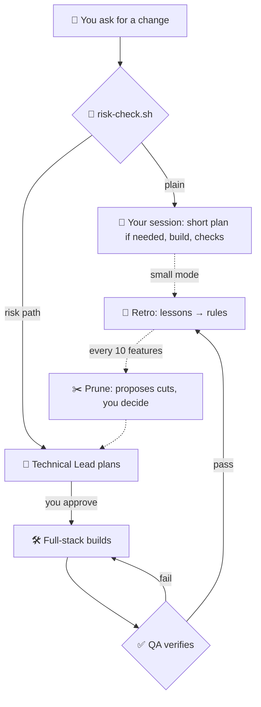
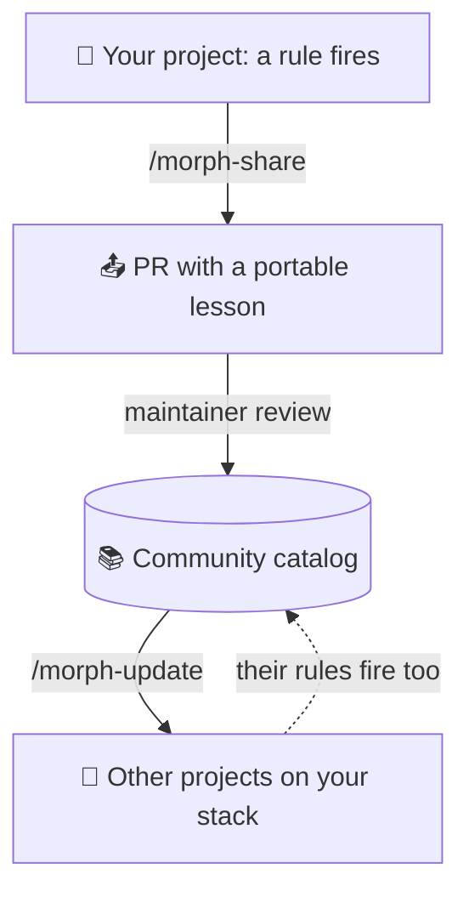

<div align="center">


# Morphness

**A fail-closed guard for Claude Code, with a process on top that learns from your project**

🛡️ **Guard** · 🧭 **Plan** → 🛠️ **Build** → ✅ **Check** → 🔁 **Retro** → ✂️ **Prune**

It starts generic and morphs into your project's own harness,<br>
one retro and one prune at a time.

[](https://morphness.dev/trust.html)
[](LICENSE)
[](#-install)
[](#-what-you-get)
[](lessons/)
[](https://github.com/antarsoft/morphness/stargazers)
[](CONTRIBUTING.md)
[](https://discord.gg/zcZTAQq)

🌐 [Website](https://morphness.dev) · 🚀 [Install](#-install) · 🔒 [The guard](#-the-guard) · ✨ [Why](#-why-use-it) · 🧠 [How it works](#-how-it-works) · 📦 [What you get](#-what-you-get) · 🧰 [Make it yours](#-make-it-yours) · 🦋 [How it morphs](#-how-it-morphs) · 🌍 [Community](#-community-lessons) · 🤝 [Contributing](CONTRIBUTING.md) ·  [Discord](https://discord.gg/zcZTAQq)

</div>

---

**Morphness** is an open-source harness for [Claude Code](https://claude.com/claude-code). Its core is
a **guard**: a hook that checks Bash, file, Grep, WebFetch and MCP tool calls before they run, blocks
the ones that could hurt a shared environment or leak a secret, asks you before deploys, publishes and
merges, and blocks the call when it can't run its check.

On top of the guard sits a process you can lean on as much as a change needs: a plan you approve,
a record of every check that ran, and a retro and prune loop that turns your project's misses into
rules. It is a set of subagents, `CLAUDE.md` / `AGENTS.md` rules, checklists and scripts for AI coding
agents. If you have been writing those by hand (what people now call *harness engineering* or
*context engineering*), Morphness is that work packaged, with a loop that keeps it current.

Every release is tested, and the results are public, including the known limits: [see the latest run](https://morphness.dev/trust.html).
The page and the Tests badge are made again at every release tag and name the release, commit and date they tested.

**One agent by default.** You talk to a **Technical Lead** in your main Claude Code session, and for
most changes that session does the work alone, with the guard watching. Before each change a script,
`scripts/risk-check.sh`, reads the files it will touch. Only a change to a risk path (sign-in, money,
the database schema), one that deletes stored data or one to more than a few files brings in a
separate **Full-stack** agent to build and a **QA** agent to verify; a new migration that only adds
stays in your session, with database tests and one code review. You can also ask for full mode. After
a feature, a short retrospective turns what went wrong into rules. After every ten learnings files (you
can set 8 to 30), a prune audits those rules and proposes cutting the ones that never fire; you decide
each one.

The harness you have after fifty features is shaped by your project, your stack and how you work.

> [!NOTE]
> Morphness grew out of about 150 features on a real product. Its starting checklist and its first
> lessons come from problems that actually happened there.

## 🔒 The guard

`scripts/guard.sh` runs as a Claude Code `PreToolUse` hook. It reads a Bash command the way the shell
does (each command in a chain, inside `$(…)`, `bash -c`, `eval`, `find -exec`, after `sudo`, `xargs`
and other wrappers), then lets the call through, asks you, or blocks it and tells the agent why. A
block has no switch and beats an ask. The full list is in [template/harness/GUARD.md](template/harness/GUARD.md).

| | What it covers |
|---|---|
| ⛔ **Blocks** | Pushes to your environment branches (`main`, `dev` and the rest, by any refspec, a delete included) and force-pushes on any branch. Reading or writing secret and credential files (`.env*`, keys, cloud and SSH credentials, `.netrc` and similar names, through a symlink too), and a recursive `grep` over a folder that holds one. Printing the whole environment (a bare `env`, `printenv`, `set`). Changes that would switch the guard off: its own scripts, `.claude/settings.local.json`, and settings or config edits that drop a protection. `gh secret` and `gh variable` writes. Remote database writes from the migrate and push commands it knows (`supabase db push`, `prisma migrate deploy`, `wrangler d1 … --remote` and similar). |
| ✋ **Asks you** | Deploys and calls to cloud CLIs that do more than read, publishes, merges and other code-host writes, other edits to its settings, CI definitions and git hooks, `git config` keys that run commands, `git reset --hard`, moving an environment branch in your clone (`git update-ref`, a fetch into it) and wide deletes. Database clients (`psql` and similar) aimed at a non-local host unless the statement only reads, and `prisma db push` or `drizzle-kit push`. Code fetched and run (`curl … \| sh`), and package runners (`npx`, `uvx` …) on a package the project doesn't have. Any MCP tool whose name isn't a read, judged by the name; by default the GitHub pull request tools may open, update and comment on PRs in your own repository without a prompt. |
| 🧱 **Fails closed** | It blocks the call when it can't run its check: `scripts/guard.sh` missing, no `python3` or `awk`, its config reader missing, input it can't parse, a crash, or a check that runs past 15 seconds. An owner can set `guard.fail_open: true` to let calls through when `python3` is missing. |
| 👁️ **Sees** | Bash, Read, Edit, MultiEdit, Write, NotebookEdit, Grep, WebFetch and every MCP tool. Other tools (Glob, WebSearch, Agent, and the rest) get Claude Code's own permission prompts; a subagent's own calls are checked like any other. |

**Its limits.** It stops accidents, not intent: it is not a sandbox. It reads commands as people type
them, so shell expansions it does not perform (`${IFS}`, brace lists, `$'…'` quoting) can hide a command
or a file name. It does not see the commands inside a script or Makefile target that already exists, a
secret kept in a file with an unusual name, and it lets a plain download through (`curl -o`, `wget`,
`git clone`, `npm install <package>`) unless it writes a protected file. A database write through a client or tool it has no rule for is not caught,
so add your own deny rules for the connectors you use. If the hook hangs past its 60 second timeout, Claude
Code runs the call. The real guard for shared environments is the host: branch
protection, and environment secrets only you hold. The self-test replays every guard case, on every
sample project when the guard or its cases change, and the [results page](https://morphness.dev/trust.html) lists the known gaps.

## ✨ Why use it

Morphness doesn't make the model smarter: a capable model in a plain session already gets most
changes right. What it adds is a guard and a process around the model, and it spends that process
where it pays: on changes to the risky parts of your code.

| Reason | What that means |
|--------|-----------------|
| 🛡️ **Safe by default** | The guard blocks what could hurt a shared environment or leak a secret, asks before deploys, publishes, merges and connector writes, and blocks the call when it can't run its check. It stops accidents, not intent, so branch protection and environment secrets on the host stay the real guard. [What it covers](#-the-guard). |
| 🧭 **Plan first, then build** | A change that alters behaviour gets a plan with testable acceptance criteria, and you approve it before code is written: a short plan off the risk paths, a full one on them. A bug fix off the risk paths starts from a failing test instead, and a change that alters no behaviour (docs, formatting) needs no plan. |
| ✅ **Done means verified** | Every change records the checks it ran with their exit codes, and a planned change records the evidence for each criterion on the final commit. A separate QA agent checks the work in full and bug mode; in light, small and research mode there is no QA agent, and your session checks its own work. |
| 🧪 **Tested as a kit** | Every change to the kit's template, update notes or tests runs a self-test that installs it into sample projects (Next.js with Supabase among them), replays the guard's cases and brings the previous release up to date, so an update doesn't break an install that already works. The [results page](https://morphness.dev/trust.html) shows the latest run, with public scanners and the known limits. |
| 🔁 **Learns from its own mistakes** | Retros turn real misses (a failed QA round, a review fix, a bug you report after a pass) into rules. Prunes propose cutting, merging or moving out the rules that never fire, and you approve each cut, so the instructions your agents read stay short and earned. |
| 💲 **Know what each feature costs** | Each hand-off ends with an estimated dollar cost from Claude Code's own transcripts, split by agent, so you can compare features and tune effort. Useful as an estimate on a Pro or Max plan too. |
| 🧰 **Yours to configure** | Branches, environments, checks, modules, risk areas, models, effort and loop limits all live in one `harness.config.yml`. Every rule and checklist is a plain Markdown file in your repo, so you can change anything. |
| 🧩 **Works on any codebase** | New or existing repos, including ones that already have a `CLAUDE.md`, `AGENTS.md` or their own agent setup, monorepos with several apps, and folders that aren't a git repo or online yet. Any language or framework. |
| 🌍 **Improved by the community** | Lessons in the catalog come from rules that ran in a real project, with the evidence they carry. `/morph-update` offers the ones that match your stack; `/morph-share` sends yours back. [More below](#-community-lessons). |

## 🚀 Install

**🤖 Ask your agent.** Copy this into any Claude Code session inside your repo. It works for a new
or an existing project:

```text
Set up the Morphness agent harness in this repo by following
https://github.com/antarsoft/morphness/blob/main/INSTALL.md step by step.
Scan the repo first, then ask me the setup questions one at a time with your suggested answer.
Keep my existing files, install skills or connectors only after I say yes, and put every change
on a new branch for me to review.
If Morphness is already installed here, follow its UPDATE.md instead and show me what changed upstream.
```

**🔌 Or as a plugin:**

```text
/plugin marketplace add antarsoft/morphness
/plugin install morphness@morphness
/morph-init
```

<details>
<summary><b>🛠️ Or by hand</b></summary>

```bash
tag=$(git ls-remote --tags --refs --sort=-version:refname https://github.com/antarsoft/morphness 'v*' \
  | sed 's|.*refs/tags/||' | grep -E '^v[0-9]+\.[0-9]+\.[0-9]+$' | head -n 1)   # the newest release
git clone --depth 1 --branch "$tag" https://github.com/antarsoft/morphness /tmp/morphness
/tmp/morphness/scripts/install.sh /path/to/your/repo   # copies, never overwrites
# then, in Claude Code inside your repo, paste:
#   Follow /tmp/morphness/skills/morph-init/SKILL.md to set up the harness here
# (or install the plugin above and run /morph-init)
```

The copied files still hold `{{…}}` placeholders until the setup fills them in.

</details>

The setup (`/morph-init`, or your agent following `INSTALL.md`) works for new and ongoing
projects. On an ongoing one, it scans the repo first and suggests answers. Then it asks a short
series of questions, one at a time, each with a suggested answer: what you're building, who
approves, where you run Claude, your stack, the commands behind each check, branches and
environments, who merges, and which optional modules you want. It explains each technical term the
first time it comes up, so you don't need to be a developer to answer. You can also point it at a
brief or fill in an answers file instead.

If the folder isn't a git repository yet, the setup starts one, and it can create the GitHub
repository on your yes. With your yes it also applies branch protection on the host, or gives you
the steps to do it yourself.

It suggests skills, connectors and community lessons that fit your stack, and installs only the ones
you accept. Existing files such as your `CLAUDE.md` are kept, settings are merged with the diff
shown, and everything lands on a branch for you to review.

<details>
<summary><b>📋 Requirements and cost</b></summary>

- **Claude Code** with plugins, subagents (the Agent tool) and effort levels.
- **Models:** sonnet in every role but the legal writer by default; `/morph-init` offers opus for
  planning and building. The legal writer is set to fable; set it to opus if fable isn't available to you.
- **Tools:** bash, git, python3 (3.7 or later), awk and perl are required. python3 runs the guard
  hook (without it the guard blocks every call it checks), the risk check, the end-of-task checks and the
  counting and cost scripts; awk reads `harness.config.yml`; perl strips a module's text when you
  remove it. `/morph-doctor` checks them all, and each session start checks python3. `gh` is optional: `/morph-share` uses
  it to open its PR, and setup uses it to apply branch protection or create the repository (each has
  a manual fallback).
- **Cost:** process costs tokens, so Morphness spends it where the risk is. A change off the risk
  paths runs in your session alone, with no subagent: no plan for docs or config, a short plan for a
  behaviour change. Even so, small mode costs more than the same change in a plain session, because
  it writes the plan and runs every check. A full-mode feature (plan, Full-stack, a code review on a
  risk path, QA) costs several times what a plain session would. Every role but the legal writer runs
  on sonnet by default. Every hand-off ends with a `Cost ≈ $…` line priced at public API rates
  (`harness/MODEL_PRICES.md`, editable for your own). Tune spend with the effort levels in
  `project/HARNESS_AGENTS.md` § Effort per feature and the risk paths in `project/CONTROLS.md`.

</details>

### What setup leaves in your repo

On a new branch: `harness.config.yml` with your answers, `AGENTS.md`, `CLAUDE.md` and `.claude/`
(rules, agents, guard settings), the `harness/` process docs, a `project/` folder with your stack
and check commands, `scripts/`, `.github/` and the empty `_harness/` record folders. Nothing is
overwritten, and you review it as a normal PR.

### Your first feature

1. Ask for the change in the main chat. The Technical Lead names the files it will touch and runs
   `bash scripts/risk-check.sh` on them, which picks the mode. Your wording ("quick fix", "no time
   for QA") never changes it; you can force a mode yourself.
2. **Off the risk paths**, your session works alone: a short plan you approve when the change alters
   behaviour, then the change, its tests and every check, recorded on the PR.
3. **On a risk path**, the Technical Lead writes a full plan with acceptance criteria and waits for
   your approval, opens a draft PR and delegates the build to Full-stack. It reviews the code, QA
   checks every criterion, and the PR is marked ready once QA passes.
4. You merge (or let the Technical Lead merge into the integration branch, with `merge_by_agent`).
   You also get the feature's cost, a retro in full and bug mode, and a steps file for anything
   only you can do. When a connected service's official connector can do a step, the Technical Lead
   offers to do it instead, and runs each action only after your yes.

| Mode | When (`risk-check.sh` decides) | Who works | Plan | QA agent |
|------|--------------------------------|-----------|------|:--------:|
| **Light** | Off the risk paths, nothing changes at run time (docs, formatting, a dependency bump whose checks pass) | Your session | None | No |
| **Small** | Off the risk paths, behaviour changes (also a new migration that only adds, with database tests and one code review) | Your session | Short, you approve it | No |
| **Small bug fix** | Off the risk paths, something that worked is broken | Your session | None: a failing test first, then the smallest fix | No |
| **Full** | A risk path, a change that deletes stored data, or more files than `mode.plain_max_files` | Full-stack builds, QA verifies | Full, you approve it | Yes |
| **Bug** | Something broken on a risk path, or a production hotfix | QA writes the failing test, Full-stack fixes | Bug plan, you approve it | Yes |
| **Research** | A question, no change asked | A read-only researcher | None | No |

Before the hand-off, the risk check runs again on what the branch really changed. If a plain change
turned out to touch a risk path, it stops and switches to full mode before anything is handed off.

> [!NOTE]
> **What it isn't.** Not a sandbox: the guard stops accidents, not a determined script. It doesn't
> make the model smarter. It adds process, and process costs tokens: a full-mode feature costs several
> times a plain session, so only risky changes get the agents and clear small requests use a lean path.

> [!TIP]
> ⭐ If Morphness saves you a rework round, [star the repo](https://github.com/antarsoft/morphness) so more teams find it.

## 🧠 How it works



| Role | What it does | Model · effort |
|------|--------------|----------------|
| 🧭 **Technical Lead** | Your session. Makes plain changes itself; plans risk-path work and delegates it | sonnet · high (opus with the opus preset) |
| 🛠️ **Full-stack** | In full and bug mode, builds the approved plan and its tests | sonnet · high (xhigh for sign-in, secrets and money; opus with the opus preset) |
| ✅ **QA** | In full and bug mode, reviews the diff, runs the checks and validates every criterion | sonnet · medium (high when Full-stack is xhigh) |
| 🔎 **Researcher** | Answers a question about your code or the web with cited sources. For when you want an answer, not a change | sonnet · medium (high for architecture; opus at high with the opus preset) |
| 🗺️ **Code scout** | In full mode, maps the code a change touches before the plan, so the main chat reads only the lines it changes. Read-only by rule | haiku · medium |
| ⚖️ **Legal writer** | Writes wording that makes a legal promise | fable (or opus) · high |

These are defaults; change any of them (see [Make it yours](#-make-it-yours)). Most limits on what each
agent may edit are instructions in its prompt. What Claude Code enforces is the guard, the deny and
ask rules in `.claude/settings.json`, the end-of-task check hooks, and the tool lists of the
researcher, the code scout (read and shell only) and the legal writer.

| Skill | Use |
|-------|-----|
| `/morph-init` | Install and set up the harness. |
| `/morph-update` | Review what changed upstream (kit updates and lessons) and bring in what you accept, merged with your edits. |
| `/morph-doctor` | Check wiring, flag a due prune or stuck features, and count upstream updates waiting. |
| `/morph-module` | Add or remove an optional module (`add security`, `remove ci-cd`) on a project that already has the harness. |
| `/morph-share` | Turn rules that fired into a PR to the lessons catalog. |

Morphness runs in plain Claude Code (CLI, desktop, web). If you use a **Claude Project** with a
coordinator and threads, the `claude-projects` module adds a playbook for the Project instructions
and advised settings (coordinator sonnet · medium, feature threads sonnet · high).

## 📦 What you get

| Piece | What it does |
|-------|--------------|
| 📄 `AGENTS.md`, `CLAUDE.md`, `.claude/rules/` | A short core every session loads (pick the mode, who merges, no remote writes), and rules for tests, schema, sign-in and deploy files that load only when a task touches them. |
| 🤖 `.claude/agents/` | Full-stack (medium, high, xhigh effort), QA (medium, high), researcher (medium, high), code-scout and legal-writer subagents. |
| 🛡️ `.claude/settings.json` | The guard hook and the end-of-task checks, plus deny rules for secrets and protected-branch pushes and ask rules on merge commands, as a second layer. |
| 🗺️ `harness/` | The process: lifecycle, handoffs, checks, modes (full, small, light, bug, research), the guard's full list, release and environments, the plan checklist, model prices, and how it morphs. |
| 🧩 `harness/modules/` | Optional: Claude Projects, data access (local-first, remote read-only), browser e2e, legal wording, roadmap, CI/CD pipelines, security (threat model, secret scanning, dependency audit). |
| 🏷️ `project/` | Your project's facts: stack, the commands behind each check and their scope, risk paths, effort per area, and the official connector for each service you use. |
| 🎛️ `harness.config.yml` | Branches, environments, apps, branch protection, who merges, release tags, modules, named checks, CI gate, risk areas, mode, models and effort, cost tracking, the guard's switches, loop limits. |
| 📜 `scripts/` | The guard, the risk check, the end-of-task checks, the prune counter, the feature cost estimate and the evidence summary. |
| 🐙 `.github/` | A PR template for drafts, release notes and hotfixes, and the branch-protection ruleset. |
| 🗂️ `_harness/` | Runtime: feature folders, learnings, research, prunes, releases. |
| 🧬 `profiles/` | Optional starting points for known stacks: detect rules, check commands, permissions and matching lessons. The first one is Next.js + Supabase. |

## 🧰 Make it yours

`/morph-init` writes your answers into `harness.config.yml`, and you can edit it by hand any time.
Run `/morph-doctor` afterwards to check the wiring. An abridged example:

```yaml
branches:
  integration: dev          # feature branches start here and PRs target it
  production: main          # moves only through a release
  default: dev              # the code host's default branch

environments:               # in the order code moves through them; add staging, or keep one
  - { name: dev, branch: dev, deploy: host, real_data: false }
  - { name: production, branch: main, deploy: host, real_data: true }

branch_protection: { enabled: true, required_approvals: 0, delete_merged_branches: true }
merge_by_agent: never       # or integration: the Technical Lead merges ready feature PRs there
release_tags: true          # tag every production merge; false, or per-package for monorepos

modules: [roadmap, data-access, browser-e2e]

checks:                     # commands for each name live in project/CONTROLS.md
  before_qa: [install, typecheck, lint, unit, build]
  before_signoff: [install, typecheck, lint, unit, build, e2e-full]

ci_gate: false              # true: CI on the PR is the gate; false: the QA record is
risk_areas: [auth, billing, migrations]   # their paths in project/CONTROLS.md § Risk paths get full mode

mode:
  plain_max_files: 6        # a change to more files than this gets full mode
  force: auto               # or full / plain for every change

agents:
  fullstack: { model: sonnet, default: high, variants: [medium, high, xhigh] }
  qa: { model: sonnet, default: medium, variants: [medium, high] }
  researcher: { model: sonnet, high_model: sonnet, default: medium, variants: [medium, high] }

cost: { track: true, prices: harness/MODEL_PRICES.md }   # estimated $ per feature

loop:
  retro_max_items: 3        # usual action items per retro (soft limit)
  prune_every: 10           # features between prunes (8 to 30)
  qa_max_rounds: 2          # QA rework rounds before asking you
```

Beyond the config, everything is a file in your repo that you own:

| To change | Edit |
|-----------|------|
| Check commands and when each runs, risk paths, stack facts, test locations | `project/CONTROLS.md`, `project/STACK.md`, `project/TESTING.md` |
| Skills, connectors and each service's official MCP | `project/SKILLS_AND_MCPS.md` |
| Prices used for the cost estimate | `harness/MODEL_PRICES.md` |
| Your own plan checklist items | `project/PLAN_CHECKLIST.md` |
| Agent instructions for this project | `project/agents/<role>.md` (added on top of the generic roles) |
| Model and effort per subagent | `.claude/agents/*.md` |
| What agents may never do | `.claude/settings.json` (deny and ask rules) |
| The process itself | `harness/`, through a retro or prune ([MORPHING.md](template/harness/MORPHING.md)) |

## 🦋 How it morphs

Once installed, the harness belongs to your repo, and the loop is what changes it:

1. 🔁 **Retro** after each full or bug-mode feature: only the action items its findings call for (usually
   up to three, none is fine), each with why it was raised, which the Technical Lead approves, defers
   or skips. A rule must name a miss it would have caught.
2. 📝 **Learnings** file per feature. Small mode writes one too, as its look-back; a small bug fix
   writes one only when something went wrong.
3. ✂️ **Prune** every ten learnings files. The rule audit sorts rules into *fired*, *never fired*,
   *insurance* and *too new*. The prune proposes keeping, merging, shortening, moving to on-demand or
   removing each rule, and trials (an effort level, a new check, a model) are judged by their KPIs.
   You decide every row; nothing is cut on its own. It also shows each feature's cost against the last
   window, checks whether the problem behind each retro item came back, and reads the short
   look-back on research files. Every hand-off ends with a `Prune counter: N/10` line, so you see a
   prune coming.

See [template/harness/MORPHING.md](template/harness/MORPHING.md).

### 🌱 How it learns: a real example

The loop corrects itself too. In one project, a run of clean features each ended with a retro that
added a rule "just in case". Nothing had failed, yet the checklists the agents read kept growing,
and the always-loaded size gauge never noticed because checklists aren't always loaded. The prune
caught it.

| | Before | After |
| --- | --- | --- |
| **Retro rule** | Any finding could add or tighten a rule. | A rule must name a miss in that feature it would have caught: a failed QA round, a review fix, a human correction, rework, or a bug after a pass. A clean feature adds no rule. |
| **Size** | Only the always-loaded files were measured. | The checklists get their own budget, and the prune counter prints `Checklists: X/Y KB` and says when a prune is due. |
| **Over budget** | Rules kept being added. | An approved rule removes at least as much text as it adds, or waits for the prune. |

The fix shipped as a change to Morphness itself, with a short note under [`updates/`](updates/)
that `/morph-update` offers to every install, so one project's lesson reaches the rest.

### 🔄 Staying up to date

Upstream keeps improving too: new modules, sharper process rules, fixes. Nothing upstream ever
overwrites your copy. Instead:

- `/morph-update` lists what changed in Morphness since your copy last synced (released changes only) and fits your project,
  says why each item matters, and applies only what you accept. A file you never edited takes the
  new version; a file you edited gets a merge that keeps your rules, shown before it's written.
- Every prune runs the same check read-only, so a harness that falls behind gets noticed.
- No clone needed: the check reads release notes and template text from
  github.com/antarsoft/morphness; it executes nothing and falls back to a local copy when GitHub
  can't be reached (or always, with `updates.source: local`).
- No plugin? Tell your agent: *"Follow https://github.com/antarsoft/morphness/blob/main/UPDATE.md"*.

Each kit change ships with a short note in [`updates/`](updates/), and every release is listed in
[CHANGELOG.md](CHANGELOG.md).

## 🌍 Community lessons

> 💜 **From the community, for the community.** Your harness learns from your project. The catalog
> learns from everyone's.

Each Morphness project runs its own retro and prune loop. When a prune shows a rule actually
**fired** (it caught a real problem), that rule can leave your repo and help every other team on
a similar stack.

The catalog has **116 lessons**, most of them from the product Morphness was built on.
82 ship inside the kit as its default rules, and the other 34 are offered when they match your stack.
52 of them have no `fired` count yet: they came from the first project's records, which didn't count
how often each rule fired.
It grows with every PR, and **yours could be the next project in it**.



| Catalog | Lessons | What's in it |
|---------|:-------:|--------------|
| 🧠 [`practice/`](lessons/practice) | 71 | Process rules for any stack: planning, QA, handoffs, agent hygiene |
| 🧱 [`stack/`](lessons/stack) | 25 | Framework and tool traps: Next.js, Drizzle, Playwright, pnpm, Chromium |
| ☁️ [`service/`](lessons/service) | 20 | Hosted-service gotchas: Supabase, Vercel, Paddle, GitHub Actions, Claude Code web |

Built-in rules stay in the catalog so other projects can add their evidence. The counts here and on
the site come from `scripts/lesson-stats.sh`, and the self-test fails when they drift.

**How to contribute**

1. 📤 **Share.** After a prune, run `/morph-share`. It picks the rules that fired, strips anything
   project-specific, and drafts a PR to [lessons/](lessons/).
2. 🔍 **Review.** A maintainer checks the lesson is new, portable and backed by evidence. Lessons
   are amended, never replaced: your report strengthens an existing lesson when one matches.
3. 📥 **Spread.** Everyone running `/morph-update` sees the new lesson if it matches their stack,
   and picks whether to take it.

A new lesson needs evidence (a `fired` count from a prune audit) to be accepted: the maintainer checks
it at review, and `scripts/check-lessons.sh` checks every lesson carries an evidence field. See
[CONTRIBUTING.md](CONTRIBUTING.md) and [lessons/README.md](lessons/README.md).

## 🏗️ Built with Morphness

Products and projects that run on a Morphness harness. Add yours with a one-row PR (see
[CONTRIBUTING.md](CONTRIBUTING.md) § Showcase).

| Project | What it is | Stack | By |
|---------|------------|-------|----|
| [**Twinpage**](https://twinpage.app) | Split testing for websites, where Morphness started ([evidence](showcase/twinpage.md)) | Next.js, Supabase | [@ziadantar90](https://github.com/ziadantar90) |

---

<div align="center">

**💜 Like it? Share it**

[](https://x.com/intent/post?text=Morphness%3A%20a%20self-improving%20agent%20harness%20for%20Claude%20Code&url=https%3A%2F%2Fgithub.com%2Fantarsoft%2Fmorphness)
[](https://www.linkedin.com/sharing/share-offsite/?url=https%3A%2F%2Fgithub.com%2Fantarsoft%2Fmorphness)

⭐ [Star the repo](https://github.com/antarsoft/morphness) · 🐛 [Report an issue](https://github.com/antarsoft/morphness/issues) · 🤝 [Contribute a lesson](CONTRIBUTING.md) ·  [Join the Discord](https://discord.gg/zcZTAQq)

<sub>Released under the [MIT License](LICENSE) · [Changelog](CHANGELOG.md) · [Code of Conduct](CODE_OF_CONDUCT.md) · [Security](SECURITY.md). Built by [Antarsoft](https://github.com/antarsoft).</sub>

</div>
