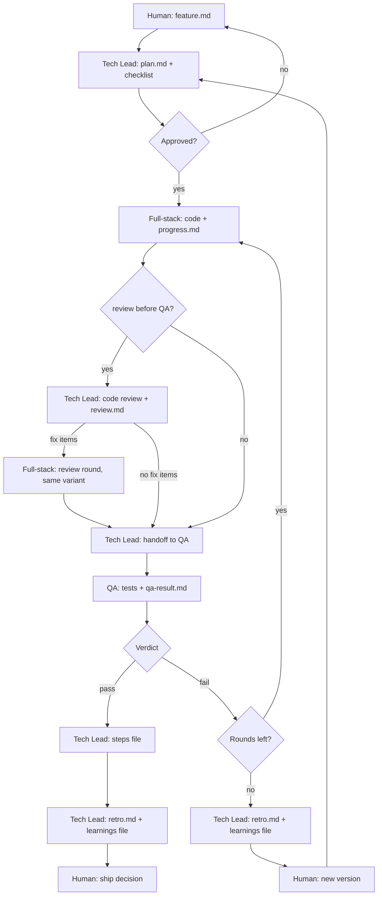

# Harness setup and runbook

Operational guide for the harness. Role definitions: [STRATEGY.md](./STRATEGY.md). Templates: [HANDOFFS.md](./HANDOFFS.md) and [templates/](./templates/). Structural settings (branches, modules, named checks, loop limits): `harness.config.yml`.

---

## Design goals

- **Separation:** plan, implement and validate with different agents.
- **Traceability:** every feature version has `feature.md` → `plan.md` → `progress.md` → `qa-result.md`.
- **Human gate:** no implementation until `plan.md` is approved.
- **Bounded QA:** at most `loop.qa_max_rounds` QA rounds per version (default two), then the human and a new version.
- **A harness that learns:** every feature ends with a retro; every `loop.prune_every` features the rules are audited ([MORPHING.md](./MORPHING.md)).

---

## Lifecycle status

Put this near the top of `plan.md`:

```text
Status: draft | awaiting-approval | approved | passed | failed-escalated
```

| Status | Who acts next |
|--------|------------|
| `draft` | Technical Lead completes the plan |
| `awaiting-approval` | Human |
| `approved` | Full-stack engineer, then (code review if `xhigh`) QA engineer |
| `passed` | Human merges the ready PR into the integration branch (or the Technical Lead, with `merge_by_agent: integration`) |
| Release | Separate step, not per feature: integration branch → production branch when the human says "release" ([RELEASE.md](./RELEASE.md)) |
| `failed-escalated` | Human chooses a new version or direction |

Whether dev or QA is running is visible from `progress.md` and `qa-result.md`; the plan status doesn't track it. The Technical Lead sets `passed` at the QA pass hand-off, in the commit that writes the steps file (or sets **Steps file:** `none`; § After QA pass, step 4), and `failed-escalated` on the last allowed QA fail. The human may approve by message or by setting **Status** to `approved` and filling § Approval in `plan.md`. When the human approves by message, the Technical Lead sets `Status: approved` (with the date) in `plan.md` and commits it before the first Full-stack delegation: the agent reads the file, not the chat, and stops on `awaiting-approval` (learned: a plan still marked pending in the file let the human's chat approval and the agent's view disagree).

---

## QA iteration (per version)

With the default `loop.qa_max_rounds: 2`:

1. Dev complete → **QA round 1**.
2. **Fail** → Full-stack (the same variant) addresses the issues in `qa-result.md` → **QA round 2** (a `## Round 2` section in `qa-result.md`). Round 2 is scoped to the failed and affected ACs unless the rework touches a cross-cutting path ([agents/qa-engineer.md](./agents/qa-engineer.md) § Round 2, [CONTROLS.md](./CONTROLS.md) § Cross-cutting paths).
3. **Fail** again → `failed-escalated` → human; **no** further QA round on the same version.

A different limit in `harness.config.yml` changes only the count; the last allowed fail always escalates.

---

## Code review before QA

Only when the plan's **Agent effort → Full-stack** is `xhigh` (the plan says **Code review before QA: yes**)<!-- module:security -->, and, with the `security` module, for every plan with **Security feature: yes** (a bug plan: **Security review before QA: yes**), which gets step 2 and steps 3 to 5 whatever its effort ([modules/security/](./modules/security/README.md) § Security review before QA)<!-- /module:security -->. QA tests the acceptance criteria; this review looks for bugs outside them (for example a missing ownership filter on a route no AC names). It is read-only, it is not QA, and it doesn't replace QA.

1. After dev completes and before QA, the Technical Lead runs `/code-review high` on the feature diff, with no `--fix` and no `--comment`. The Technical Lead runs the `code-review` skill itself on the first pass (a subagent that doesn't have the skill, or reviews by hand, doesn't count). A second-round reviewer gets the dismissed list from `Plan/review.md` so it doesn't re-report settled items. When the environment has no `code-review` or `security-review` skill, the TL launches a read-only subagent with the same scope and brief instead, and `Plan/review.md` opens with `Review by: subagent (<skill> not available)`; the review is never skipped.
2. When the plan touches a risk area (`risk_areas` in `harness.config.yml`, for example auth, tenancy or access control, a public API, money), the Technical Lead also runs `/security-review`. It needs `origin/HEAD`, which cloud checkouts may not have: run `git remote set-head origin <default-branch>` first if `git rev-parse origin/HEAD` fails. The TL's brief names the files the review must read in full: the changed server-side handlers, the auth or ownership check they rely on, any vendor client wrapper, and their tests. The review lists the files it read in full and takes at least 15 tool calls; a pass below that doesn't count and is rerun. Before moving on, the TL pastes the reported tool-call count into `Plan/review.md` as one line (`Security review: N tool calls`) with the files read in full, and sends a review under 15 back to run again before QA (learned: thin security passes of 5 to 12 calls missed issues and left no record). After the review fixes, it runs again on the final code.
3. The Technical Lead writes the findings to `Plan/review.md`: the verbatim list, each item marked `fix` or `dismissed: <reason>`.
4. `fix` items go back to the **same Full-stack variant** as a review round. A review round doesn't count as a QA round.
5. Then QA runs as usual and also confirms each `fix` item in `qa-result.md`.

No `fix` items → go straight to QA with `review.md` on disk. A review result never ends the TL's turn: write `review.md` and launch the fix round (or QA) in the same turn.

### Findings from a review subagent

Any review done by a subagent (design, code, security, legal) is model output. Before its findings become plan items, the Technical Lead checks each one against the source (`file:line`) and writes any correction into the review file, marked "TL correction". Corrected or refuted items are resized or dropped in the plan.

---

## Modes

See [MODES.md](./MODES.md). Summary:

| Mode | Uses `_harness/features/...` | Agents |
|------|------------------------------|--------------|
| **Full** | Yes | Yes |
| **Light** | No | None: the main chat makes the change and runs the named checks |
| **Small** | Yes, with the short small plan | None: the main chat builds, runs the checks and fills the plan's § Check; a learnings line instead of `retro.md` |
| **Bug** | Yes, with the short bug plan | Yes: QA writes the failing test first, then Full-stack fixes, then QA re-runs; a learnings line instead of `retro.md` |
| **Research** | `_harness/research/` only | Researcher only; no code, no QA, no retro |

---

## Claude Code execution

| Role | How |
|------|-----|
| Technical Lead | Main session; follows `AGENTS.md` and this folder |
| Full-stack engineer | Agent tool subagent with the path to `plan.md`; implements in the codebase; edits only `Development/progress.md` under that feature |
| QA engineer | Agent tool subagent; reads `plan.md` and `progress.md`; runs the checks in [CONTROLS.md](./CONTROLS.md); edits only `QA/qa-result.md` |
| Legal writer | Agent tool subagent (legal module); edits only `Legal/legal-copy.md` | <!-- module:legal -->
| Researcher | Agent tool subagent with the absolute path of its research file; no shell or edit tools: it replies with the sections between the file's two lines, and the Technical Lead writes them in ([MODES.md](./MODES.md) § Research mode) |
| Model and effort | Set in `.claude/agents/*.md`; the plan's **Agent effort** picks the variant (`project/HARNESS_AGENTS.md`) |

Always pass **absolute paths** to the feature version directory in subagent prompts. Pick the subagent variant the plan names; never rely on the session's default model or effort.

---

## Effort per feature

Each `plan.md` has an **Agent effort** section naming the Full-stack and QA level, with a one-line reason. The human approves it with the plan. Effort is set explicitly so runs don't depend on each person's session default. The variants that exist are in `harness.config.yml` → `agents`; their subagent names and models are in `project/HARNESS_AGENTS.md`.

| Role | Min | Default | Max | Not used |
|------|-----|---------|-----|----------|
| Full-stack | `medium` | `high` | `xhigh` | `low` (too careless for shipped code), `max` (slow and costly; little gain over `xhigh` at normal feature sizes) |
| QA | `medium` | the project's `agents.qa.default` | `high` | `low`; `xhigh` and above (QA works through a fixed AC list, so extra depth pays off less) |
| Researcher | `medium` | `medium` | `high` | `low` (misses what it isn't pointed at); `xhigh` and above (breadth matters more than depth, and the TL checks the key findings) |

The researcher's level goes in the research file's **Researcher effort** line, not in a plan: `high` when the question is about architecture, touches a risk area, or decides a feature that will run at `xhigh`; `medium` otherwise.

### Choosing a level

- **`medium`**: the default for a **pattern-copy plan**, one that names an existing file or feature it copies (a page, form, settings field, test or doc) and adds no logic beyond it. Also renames, config or version bumps, and doc-heavy changes.
- **`high`** (default otherwise): normal feature work with new logic, such as a new flow, a new route or data path, or a screen that doesn't follow a single existing pattern.
- **`xhigh`** (Full-stack only): security, money, tenancy or access control, concurrency, public APIs, new architecture. Brings the code review before QA.
- **Never `medium` for Full-stack** when the plan touches a risk path (`project/CONTROLS.md` § Risk paths, the areas in `risk_areas`), even when it copies a pattern. Light and small mode, which `scripts/risk-check.sh` gives only off those paths, run no subagent ([MODES.md](./MODES.md) § Working alone).
- **QA is `high`** whenever the plan touches a risk path<!-- module:data-access --> or is a data-access feature<!-- /module:data-access -->, even if Full-stack is `medium`. Otherwise the project's QA default.

### Split large features by risk

When a feature has both an `xhigh` core (access guards, money, concurrency, a public API, numbers users act on) and a sizeable ordinary part (screens, forms, docs), plan it as two features. The first, at `xhigh`, delivers the risky core with its tests: data layer, server-side handlers, shared logic. The second, at `high`, builds the UI on top of it. Each gets its own plan, QA pass and steps file. Keep one feature when the ordinary part is small, since a second QA pass then costs more than it saves.

### Model of the Technical Lead

The Technical Lead runs rarely (plans, reviews, retro decisions) but a miss there costs a rework round, so it runs at `high` effort on the model the project chose (`agents.technical_lead` in `harness.config.yml`; the default is Sonnet, and the Opus preset suits projects where a missed edge case is costly). It is the session's model, not a file in `.claude/agents/`; where it is set is in `project/HARNESS_AGENTS.md`. On Sonnet, the plan, QA and the checks carry the quality; consider the Opus preset for risk-area work.

Delegating research to the researcher doesn't lower the Technical Lead's level: it still frames the question, checks the findings and decides, and it still reads the code its plans change. It saves tokens (the search stays in the researcher's context), not judgement.

Model or effort changes are tried as **trials** before they become the rule ([MORPHING.md](./MORPHING.md) § Trials).

---

## Where QA can run

Plans list the ACs that need the running app to reach its database or other services under **QA scope → Needs live app/services** ([templates/plan.md](./templates/plan.md)).

**Order for those ACs:**

1. **Local services first.** In any session that can start the project's local stack (commands and seeded logins: `project/CONTROLS.md` and `project/STACK.md`), start it, build and start the app, and test with the seeded login.
2. **`deferred: local` only as the fallback**, when the local stack can't start in this environment. Record the command, its exit code and the error (for example a blocked image host) in `qa-result.md` as the reason. Never fail an AC only because a service is unreachable.

No QA step writes to a shared remote environment (integration or production): no test users, no seed data, no privileged keys for it. `project/HARNESS_AGENTS.md` § Where QA can run has this project's table of environments (local CLI, cloud sessions) and what each can reach.

Deferred ACs go into the feature's steps file ([HANDOFFS.md](./HANDOFFS.md) § Steps file). The human runs them, or asks the Technical Lead to run the QA agent from a session that can reach the services.

**Agents running at the same time:**

- **One local stack per session.** Two agents that start, stop or reset the same local stack at once collide. Serialize them (a lock around each command, see [HANDOFFS.md](./HANDOFFS.md) § Parallel plans), or give one a scope that never touches the stack.
- **A worktree-isolated agent starts from the repository's base commit, not the feature branch.** Plan docs and earlier unmerged work are missing from that tree. Pass plan and feature-folder paths as absolute main-checkout paths, tell the agent to leave its work uncommitted, and commit and merge its branch back before handing to QA. Work that builds on unmerged feature-branch code runs in the main checkout instead, with no other agent editing.

---

## First feature checklist

1. `_harness/features/<slug>/1/Plan/feature.md`: human intent.
2. Technical Lead: `plan.md`, [PLAN_CHECKLIST.md](./PLAN_CHECKLIST.md) → `awaiting-approval`.
3. Human approves → Technical Lead sets `approved` in `plan.md` and commits → Full-stack implements → `progress.md` complete.
4. Full-stack `xhigh`<!-- module:security --> (or, with the `security` module, a security feature)<!-- /module:security -->: Technical Lead review → `Plan/review.md` (§ Code review before QA).
5. QA: `qa-result.md` → pass or fail (within `loop.qa_max_rounds`).
6. Pass: Technical Lead writes the steps file (or none) → `passed`. Last allowed fail: `failed-escalated`.
7. Technical Lead: `Plan/retro.md` and the feature's `_harness/learnings/` file (§ Retrospective).
8. Human merges the ready PR into the integration branch (or the Technical Lead, per `merge_by_agent`). Production comes later, in a release ([RELEASE.md](./RELEASE.md)).

---

## Workflow



---

## After QA pass

Technical Lead:

1. Confirm the `before_signoff` checks are recorded in `qa-result.md` on the final commit ([CONTROLS.md](./CONTROLS.md) § Merge gate).
2. Update any **project** docs the plan listed (`project/PROJECT.md`, domain docs). A status line the Full-stack engineer wrote as "Pending QA" becomes "QA pass".
3. For a UI change, confirm the screenshots from `progress.md` § Screenshots exist; the reply to the human links every one of them.
4. **Human-only steps.** Write this feature's block to **its own steps file** from [templates/steps.md](./templates/steps.md): what you did through a connector (§ Done for you), every step only the human can do (with its expected result and why no connector did it), every AC `qa-result.md` marks `deferred: local` (tell the human the feature isn't fully verified until those pass), and for a feature with migrations or remote config changes the ones to apply on the integration environment after the merge. The block heading links `qa-result.md` ([HANDOFFS.md](./HANDOFFS.md) § Steps file). None of these means no file. Where the file goes:
   - **Roadmap module off:** `_harness/features/<slug>/<version>/steps.md`.
   - **Roadmap module on:** `<roadmap.versions_dir>/<id>/steps/<slug>.md`, next to the next version's checklist, never into the checklist itself, so parallel feature branches don't conflict. Finding the next version, creating a missing version doc or checklist, and items that belong to a later version: [modules/roadmap/](./modules/roadmap/README.md). When the roadmap has no single next version, ask the human. The release and the prune fold these files into the checklist.

   In the same commit set `plan.md` **Status** to `passed` and **Steps file** to the path or `none`. Commit it on the feature branch so it merges with the PR. With nothing for the human (**Steps file:** `none`) set `passed` at once and don't wait. Then run the retrospective (§ Retrospective).
5. Push, then mark the feature's draft PR into the integration branch **ready** (open it, ready, if it doesn't exist yet), per [RELEASE.md](./RELEASE.md) § Feature PRs. Merge only when the human asks. Shipping to the production branch is a release: [RELEASE.md](./RELEASE.md).

---

## Retrospective

Every full-harness feature ends with a short Technical Lead retro. No retro in light mode; in small and bug mode the learnings file alone is the look-back ([MODES.md](./MODES.md) § Small mode step 4, § Bug mode step 6).

- **When:** after the QA pass hand-off, or on `failed-escalated`, before the next plan. Failed features need it most.
- **Inputs:** `feature.md`, `plan.md` (with its open questions and answers), `progress.md`, `review.md` if any, `qa-result.md`, the steps file if any, the agents' completion notices and any human corrections in the conversation.
- **Output:** `Plan/retro.md` from [templates/retro.md](./templates/retro.md), with its action items, each typed and routed. The TL proposes and decides them (§ Per-feature review below).
- **How many items:** as many as the feature's findings call for, and never padded to reach a number: a retro with no items is normal. Up to `loop.retro_max_items` (default 3) is the usual size. More is allowed when each extra item comes from a different finding, with one line under the table saying why this feature needed more (a long or failed feature often does). The limit is soft because every approved item costs a commit, often a new rule, and one more row for the prune to audit.
- **Why raised:** every item fills its **Why raised** column: the finding it answers (`What to improve #N`, or the Answers line it comes from) and the evidence (a QA round, a human correction, a cost figure, a file). No finding, no item. The prune reads it to judge whether the rule the item added worked: if the problem it names came back after it landed, it didn't.
- **Rules come from misses:** an item that adds or tightens a rule or checklist item names a miss in this feature that the rule would have caught: a failed QA round, a review finding that needed a fix, a human correction, rework, or a bug found after a pass. Specifics, examples or wording that restate what already went right are not items; a feature with no miss adds no rule. While `scripts/prune-counter.sh` prints `Prune is DUE` for a size budget, an approved rule item also removes or shortens existing text of at least its size, or waits for the prune (learned: over 12 clean features, 10 retros each added checklist "specifics" and the project's rule files grew by more than half with no miss behind any of them).
- **Mechanism over memo:** an item that adds a sentence to a rule, checklist or agent body says, in its **Action**, why a script, hook, test or check can't do the job instead. When the problem a rule names came back after it landed, convert the rule into a mechanism; don't add another sub-bullet (learned: the rules that held changed how something works, while reminder rules saw their problem return).
- **Real cost data:** agents' **Started** and **Ended** are notes only. The Technical Lead records duration and tool calls from each subagent's completion notice in `retro.md` § Agent runs (the `subagent_type` column carries the model and effort), filling a row as each notice arrives. Every row is filled before the single retro commit; no separate follow-up cost commit.
- **Feature cost:** with `cost.track` on (the default), run `bash scripts/feature-cost.sh` in the session that ran the feature, before the retro commit, and fill § Agent runs → Est. $ and its Technical Lead and Total rows from its table. Its last line (`Cost ≈ $… (Technical Lead $…, fullstack-engineer $…, …); API list prices as of …`) goes on the learnings file's **Cost** line and at the end of the hand-off message, next to the prune counter. It reads Claude Code's own session transcripts, which record every API call's model and tokens by kind, and prices them from `harness/MODEL_PRICES.md`: the tokens are exact, the dollars an estimate at public API prices, useful to compare features even on a Pro or Max plan. Never fill it from the completion notices: their single token figure doesn't say which tokens were cache reads, which cost a small fraction of fresh input, so it can't be priced (learned: a notice said 70k tokens for a run whose transcript showed 211k input tokens, most of them cache reads). When the session did other work before this feature, pass `--since <time the feature started>`; when the feature ran across several sessions, `--branch <feature branch>` adds them up (calls made before the branch existed are missed; say so). When it prints `Cost: not measured (…)`, write that reason instead of a figure; never estimate by hand.
- **Trials:** when the feature ran a trial (`_harness/trials/`), its learnings file gets `**Trial:** <trial-slug>`; the trial file itself isn't edited ([MORPHING.md](./MORPHING.md) § Trials).
- **Learnings:** then a 3 to 5 line entry in the feature's own file `_harness/learnings/<feature-slug>-v<version>.md` from [templates/learnings-entry.md](./templates/learnings-entry.md), never in `_harness/LEARNINGS.md` itself, so parallel feature branches don't conflict there (learned: the shared learnings file was the most common merge conflict).
- **Action items:** add each retro action item to that file's § Action items with status `open`, its **Why raised** copied from the retro.
- **Per-feature review (the TL decides):** the TL makes one decision per new item and lists the items with their decisions in the hand-off message, so the human sees them without being asked. An item that adds a step for the human, changes product behaviour or customer-facing copy, or costs money still goes to the human for the decision, and so does one tagged `cause: environment` (a quirk of this machine or session: narrow permissions, a shared session id, a missing tool): it never becomes a `project/` or `harness/` rule on the TL's own yes; the owner decides it, and writes any `.claude/settings.local.json` change themself (that file is per machine, and an agent adding to its own permissions is the escalation this rule stops) (learned: a retro turned a session's command limits into permanent rules). Decisions:
  - **approve** → status `approved`; an item that changes how a role works is `approve (trial)`: the rule lands tagged `(trial: <slug>)` with a trial file ([MORPHING.md](./MORPHING.md) § Trials, trial by default), and `approve (permanent, why)` names the exception;
  - **skip** → status `skipped`, with why;
  - **defer** → status `deferred`, noting the feature.

  Record the decision in the feature's own learnings file (the prune moves the rows into `LEARNINGS.md`). An item deferred at two consecutive retros must be approved or skipped at the second. A feature landing an item sets it to `applied`, naming the feature (in the learnings file that holds the row, or by moving the row to Applied when it is already in `LEARNINGS.md`). Undecided items stay `open`; the prune sweeps leftovers.
- **Where an approved item lands:** which file a lesson belongs in (kit, `project/`, a module, an agent body): [MORPHING.md](./MORPHING.md) § Where a lesson lands. A rule it adds ends with `(from <feature-slug>, <YYYY-MM-DD>)`, nothing longer ([MORPHING.md](./MORPHING.md) § Rule provenance). Doc and harness items ride the finished feature's PR as their own commit (they don't touch its code, so QA's pass holds) when small; a large one gets its own plan. Code items get their own feature, unless the human decides before dev starts to put one in the plan with its own AC and QA.
- **Hand-off message:** ends with the retro's new action items and the decision on each (§ Per-feature review), then the script lines pasted from their output: the `Cost ≈ $…` line from `bash scripts/feature-cost.sh` (§ Feature cost) and every line `bash scripts/prune-counter.sh` prints, run after committing the learnings file (below): `Prune counter: N/<loop.prune_every>`, the `Rules:`, `Checklists:` and `Project docs:` gauges, any `Prune proposal waiting: <path>` line and any `Trial <slug>: N/<length> features` lines. When it exits 1 (a size budget is over and no proposal is open) or prints `Prune is DUE`, write the prune proposal first (§ Prune) and end with `Prune is DUE: proposal written at _harness/prunes/<date>.md`, asking the owner to decide its rows. When it prints a `not measured` line it could not measure all of it (exit 2, or exit 1 when a budget is over too): paste that line (a missing tool, a record that isn't UTF-8) and ask the owner to fix that; never count by hand. While a proposal is open (`proposed`, or `approved` with its cuts not applied yet) the script prints `Prune proposal waiting: <path>` and no DUE line, so write nothing and paste the waiting line. With the `claude-projects` module this is the thread's closing reply, so the cost and the counter reach the owner after every feature. A light-mode task's closing message ends with its own `Cost ≈ $…` line too ([MODES.md](./MODES.md) § Light mode).
- **Prune counter:** nothing to edit. The count is the number of feature files in `_harness/learnings/`, counted on the feature branch after fetching the integration branch (its files plus the ones this branch added; a file a prune has since folded there doesn't count again). `bash scripts/prune-counter.sh` does exactly that from the last fetched `origin/<integration>` (set `PRUNE_FETCH=1` to fetch it first; it never waits on the network otherwise) and prints the lines to paste. Its `Rules:` line is the size gauge: the files Claude Code loads into every session (`CLAUDE.md`, the files it imports, and each `.claude/rules/*.md` without a `paths:` line), against `loop.rule_budget_kb`. Its `Checklists:` line does the same for `harness/PLAN_CHECKLIST.md` plus `project/PLAN_CHECKLIST.md` against `loop.checklist_budget_kb`, and its `Project docs:` line for `project/*.md` against `loop.project_docs_budget_kb`. It also prints `Prune is DUE` (replaced by the `Prune proposal waiting` line while a proposal is open) when any of them goes over its budget or `harness/TECHNICAL_LEAD.md` is over 20 KB (§ Prune), and in that case with no proposal open it exits 1, so the hand-off is not complete until the proposal is written.

---

## Prune

A prune is a review of the harness itself: which rules earn their cost. It is due when `_harness/learnings/` holds `loop.prune_every` feature files (default 10 features since the last prune; the allowed range is 8 to 30, and the counter uses 8 or 30 for a value outside it, because a rule that landed in the last 3 features is `too new to judge` and a shorter window leaves the prune little it can judge and decides trials before their escapes show), or earlier when the always-loaded rules grow past `loop.rule_budget_kb` (default 36 KB), the plan checklists past `loop.checklist_budget_kb` (default 36 KB), the project docs past `loop.project_docs_budget_kb` (default 48 KB), `harness/TECHNICAL_LEAD.md` grows past 20 KB, or a retro asks for it (learned: pruning every few features kept ending with nothing to remove, so the cadence is set by features, not days). When the counter prints `Prune is DUE`, the Technical Lead writes the proposal (steps 1-4) as its next task, before the hand-off, without asking the owner first; only step 5 waits for the owner, and the next feature doesn't wait for step 5. While a proposal is still `proposed` or `approved` and not applied (the counter prints `Prune proposal waiting: <path>` and no DUE line), later hand-offs name it instead of writing another (learned: a prune that waited for an owner who was away never ran). Why pruning matters for a morphing harness: [MORPHING.md](./MORPHING.md) § Pruning.

**Scope (what can be pruned):** rules and checklist items (`.claude/rules/*.md`, [CONTROLS.md](./CONTROLS.md), [PLAN_CHECKLIST.md](./PLAN_CHECKLIST.md), `project/PLAN_CHECKLIST.md`, `project/CONTROLS.md`), the project fact docs (`project/*.md`: condense what a plan no longer needs, and replace hand-kept lists such as every route with a pointer to the code or a generated file), the agent bodies, plan and handoff templates, enabled modules, and `LEARNINGS.md` itself (entries older than the last prune are condensed to one line each and moved to `_harness/LEARNINGS-archive.md`, as are closed Applied and Skipped rows; never delete the retro files).

**Steps**

1. **Tabulate.** Run `bash scripts/prune-counter.sh --prune` first: its `Last N features` line (average rework rounds, QA fails, total cost) is the proposal's trend line, its `Trial` lines give each trial's numbers and its `Rule tags` lines feed step 2. From the entries since the last prune (the files in `_harness/learnings/`), one row per feature: QA rounds, review round, failure causes, Full-stack and QA model and effort, and the estimated cost from its **Cost** line (`not measured` where it has none). Link each retro's run table for the split instead of copying token figures. Add the window's total cost and average per feature next to the previous window's average (from `LEARNINGS.md` § Entries). Compare with the previous window: did QA rounds, rework causes or cost per feature fall? Then, for each active trial in `_harness/trials/` that has run its length and whose escape window has closed (one prune window of features finished after its last trial feature), propose `keep` (the trial becomes the rule) or `revert` against its Pass and Revert lines, with its numbers and the `Escaped` lines traced to its features (bug-mode and fix-PR learnings files); one that hasn't carries on. The human decides each with the rule rows in step 5. Also list the window's **Escaped** lines (bug-mode learnings files), grouped by the AC, check or review that missed, so a pattern of escapes becomes a rule item. Also list the research files added since the last prune (`_harness/research/` and features' `Research/` folders) with what came of each (planned, light-mode change, no action, or never decided); research that keeps ending undecided means the questions are too wide or nobody needed the answer. Read each file's § How it went lines and propose a tweak when a pattern shows, for example "architecture questions default to `high`" when `medium` keeps getting overruled on them, or "scope library comparisons to three named options" when they keep coming back too wide; the tweak lands in `project/HARNESS_AGENTS.md` § Effort per feature or `project/agents/researcher.md` and is decided with the rule rows in step 5. Research files never count toward the prune counter. When the project tracks plan usage, ask the owner for the usage reading on the prune day (`not read yet` until they answer) and record it next to the previous prune's, as the one number that shows whether the window's model and effort changes paid off.
2. **Audit each rule.** For every rule or checklist item added or touched by a retro action item (§ Action items → Applied) plus any the TL suspects is dead, cite evidence: the retro where it caught something (`fired`) or `never fired` (no failure cause or retro mention since it landed). When the rule came from an action item, check its **Why raised**: a rule whose problem came back after it landed didn't work, whatever else it caught; propose a change to it or its removal. A rule that landed within the last 3 features is `too new to judge`, never `never fired`. A rule that prevents a costly failure but rarely triggers is `insurance`, not dead; say what the failure costs. A rule's provenance (`(from <slug>, <date>)` at its end, [MORPHING.md](./MORPHING.md) § Rule provenance) says when it landed: the `Rule tags` lines from step 1 give the features finished since that date (fewer than 3 is `too new to judge`), and the retros after it are where the problem would have come back.
3. **Propose.** For each row: `keep`, `merge` (into what), `shorten`, `move to on-demand` (a rule that never fired in two windows goes to a file read only when needed), or `remove`, with one line of why. Also list the leftovers, action items that stayed `open`, `deferred` or `approved` without landing across the window, as `still wanted` or `close as skipped`. Items are decided per feature (§ Retrospective → Per-feature review); the prune only sweeps what was left, and the TL decides the leftovers under the same rule. Then check upstream: run `/morph-update`'s read-only listing (or follow `UPDATE.md` in the Morphness repository up to its listing step) and list each pending kit update and matching lesson with one line on why it fits this project, fixes first. The listing reads GitHub read-only (or a local clone, `updates.source`); with neither reachable, write "not checked" (learned: a copy that only changes through its own retros never hears about fixes made upstream).
4. **Write** the proposal to `_harness/prunes/<YYYY-MM-DD>.md` from [templates/prune.md](./templates/prune.md), status `proposed`, and commit it on the current branch.
5. **Human approves** the rule rows (keep, merge, shorten, move, remove), the trial rows and the upstream rows (apply, decline, later) per row (default: nothing changes). Only approved rows are applied; until the owner answers, the proposal stays `proposed`. When the owner answers, set **Status** to `approved` (some rows approved) or `declined` (nothing approved) and commit it.
6. **Apply and close.** Apply approved cuts as a light-mode docs change (or a feature if they touch code), and the approved upstream rows with `/morph-update`, which also records the declined ones. Fold the learnings files in the proposal's window (`_harness/learnings/*-v*.md`; files from features that ran while it waited stay and keep counting) into `LEARNINGS.md`: each entry becomes one condensed line in § Entries (keeping its date, cost figure and **Fired** slugs, so later prunes can compare windows, count features since a rule landed and `scripts/learned-rules.sh` can show when it last fired), each feature with a **Trial** line becomes a row in that trial file's § Results (and a decided trial's file gets its **Status** and § Decision) and each action item row moves to its state's table; then delete the folded files. Move the matching action items to Applied or Skipped, and move Applied and Skipped rows and entries older than this window to `_harness/LEARNINGS-archive.md`. With the roadmap module on, fold the next version's per-feature steps files into its checklist the same way ([modules/roadmap/](./modules/roadmap/README.md)). A declined proposal gets the same fold and reset (the window's files are folded, the counter drops by them) with **Status** `declined` and a line in `LEARNINGS.md` saying so, so the same window never prints DUE again. Set **Status** to `applied` when the approved cuts are in. Then set Last prune = date and proposal path, and Counting from = newest folded entry; the counter drops by the files folded. If a size line (`Rules`, `Checklists`, `Project docs`) is still over its budget after the cuts, raise that budget in `harness.config.yml` with one line of why in the proposal, or the next hand-off prints DUE again.

The TL proposes; it never removes a rule on its own. A prune with nothing to cut is a valid result: record it and reset the counter.
