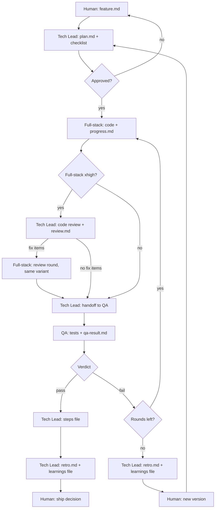

# Harness setup and runbook

Operational guide for the harness. Role definitions: [STRATEGY.md](./STRATEGY.md). Templates: [HANDOFFS.md](./HANDOFFS.md) and [templates/](./templates/). Structural settings (branches, modules, named checks, loop limits): `harness.config.yml`.

---

## Design goals

- **Separation:** plan, implement and validate with different agents.
- **Traceability:** every feature version has `feature.md` → `plan.md` → `progress.md` → `qa-result.md`.
- **Human gate:** no implementation until `plan.md` is approved.
- **Bounded QA:** at most `loop.qa_max_rounds` QA rounds per version (default two), then the human and a new version.
- **A harness that learns:** every feature ends with a retro; every `loop.prune_every` features the rules are audited ([MORPHING.md](./MORPHING.md)).

---

## Lifecycle status

Put this near the top of `plan.md`:

```text
Status: draft | awaiting-approval | approved | passed | failed-escalated
```

| Status | Who acts next |
|--------|------------|
| `draft` | Technical Lead completes the plan |
| `awaiting-approval` | Human |
| `approved` | Full-stack engineer, then (code review if `xhigh`) QA engineer |
| `passed` | Human: PR or merge into the integration branch per project rules |
| Release | Separate step, not per feature: integration branch → production branch when the human says "release" ([RELEASE.md](./RELEASE.md)) |
| `failed-escalated` | Human chooses a new version or direction |

Whether dev or QA is running is visible from `progress.md` and `qa-result.md`; the plan status doesn't track it. The Technical Lead sets `passed` at the QA pass hand-off, in the commit that writes the steps file (or sets **Steps file:** `none`; § After QA pass, step 4), and `failed-escalated` on the last allowed QA fail. The human may approve by message or by editing the Approval section in `plan.md`. When the human approves by message, the Technical Lead sets `Status: approved` (with the date) in `plan.md` and commits it before the first Full-stack delegation: the agent reads the file, not the chat, and stops on `awaiting-approval` (learned: a plan still marked pending in the file let the human's chat approval and the agent's view disagree).

---

## QA iteration (per version)

With the default `loop.qa_max_rounds: 2`:

1. Dev complete → **QA round 1**.
2. **Fail** → Full-stack (the same variant) addresses the issues in `qa-result.md` → **QA round 2** (a `## Round 2` section in `qa-result.md`). Round 2 is scoped to the failed and affected ACs unless the rework touches a cross-cutting path ([agents/qa-engineer.md](./agents/qa-engineer.md) § Round 2, [CONTROLS.md](./CONTROLS.md) § Cross-cutting paths).
3. **Fail** again → `failed-escalated` → human; **no** further QA round on the same version.

A different limit in `harness.config.yml` changes only the count; the last allowed fail always escalates.

---

## Code review before QA

Only when the plan's **Agent effort → Full-stack** is `xhigh` (the plan says **Code review before QA: yes**). QA tests the acceptance criteria; this review looks for bugs outside them (for example a missing ownership filter on a route no AC names). It is read-only, it is not QA, and it doesn't replace QA.

1. After dev completes and before QA, the Technical Lead runs `/code-review high` on the feature diff, with no `--fix` and no `--comment`. The Technical Lead runs the `code-review` skill itself on the first pass (a subagent that doesn't have the skill, or reviews by hand, doesn't count). A second-round reviewer gets the dismissed list from `Plan/review.md` so it doesn't re-report settled items.
2. When the plan touches a risk area (`risk_areas` in `harness.config.yml`, for example auth, tenancy or access control, a public API, money), the Technical Lead also runs `/security-review`. It needs `origin/HEAD`, which cloud checkouts may not have: run `git remote set-head origin <default-branch>` first if `git rev-parse origin/HEAD` fails. The TL's brief names the files the review must read in full: the changed server-side handlers, the auth or ownership check they rely on, any vendor client wrapper, and their tests. The review lists the files it read in full and takes at least 15 tool calls; a pass below that doesn't count and is rerun. Before moving on, the TL pastes the reported tool-call count into `Plan/review.md` as one line (`Security review: N tool calls`) with the files read in full, and sends a review under 15 back to run again before QA (learned: thin security passes of 5 to 12 calls missed issues and left no record). After the review fixes, it runs again on the final code.
3. The Technical Lead writes the findings to `Plan/review.md`: the verbatim list, each item marked `fix` or `dismissed: <reason>`.
4. `fix` items go back to the **same Full-stack variant** as a review round. A review round doesn't count as a QA round.
5. Then QA runs as usual and also confirms each `fix` item in `qa-result.md`.

No `fix` items → go straight to QA with `review.md` on disk. A review result never ends the TL's turn: write `review.md` and launch the fix round (or QA) in the same turn.

### Findings from a review subagent

Any review done by a subagent (design, code, security, legal) is model output. Before its findings become plan items, the Technical Lead checks each one against the source (`file:line`) and writes any correction into the review file, marked "TL correction". Corrected or refuted items are resized or dropped in the plan.

---

## Modes

See [MODES.md](./MODES.md). Summary:

| Mode | Uses `_harness/features/...` | Three agents |
|------|------------------------------|--------------|
| **Full** | Yes | Yes |
| **Light** | No | Optional single agent (never the TL writing app code) |

---

## Claude Code execution

| Role | How |
|------|-----|
| Technical Lead | Main session; follows `AGENTS.md` and this folder |
| Full-stack engineer | Agent tool subagent with the path to `plan.md`; implements in the codebase; edits only `Development/progress.md` under that feature |
| QA engineer | Agent tool subagent; reads `plan.md` and `progress.md`; runs the checks in [CONTROLS.md](./CONTROLS.md); edits only `QA/qa-result.md` |
| Legal writer | Agent tool subagent (legal module); edits only `Legal/legal-copy.md` |
| Model and effort | Set in `.claude/agents/*.md`; the plan's **Agent effort** picks the variant (`project/HARNESS_AGENTS.md`) |

Always pass **absolute paths** to the feature version directory in subagent prompts. Pick the subagent variant the plan names; never rely on the session's default model or effort.

---

## Effort per feature

Each `plan.md` has an **Agent effort** section naming the Full-stack and QA level, with a one-line reason. The human approves it with the plan. Effort is set explicitly so runs don't depend on each person's session default. The variants that exist are in `harness.config.yml` → `agents`; their subagent names and models are in `project/HARNESS_AGENTS.md`.

| Role | Min | Default | Max | Not used |
|------|-----|---------|-----|----------|
| Full-stack | `medium` | `high` | `xhigh` | `low` (too careless for shipped code), `max` (slow and costly; little gain over `xhigh` at normal feature sizes) |
| QA | `medium` | the project's `agents.qa.default` | `high` | `low`; `xhigh` and above (QA works through a fixed AC list, so extra depth pays off less) |

### Choosing a level

- **`medium`**: the default for a **pattern-copy plan**, one that names an existing file or feature it copies (a page, form, settings field, test or doc) and adds no logic beyond it. Also renames, config or version bumps, and doc-heavy changes.
- **`high`** (default otherwise): normal feature work with new logic, such as a new flow, a new route or data path, or a screen that doesn't follow a single existing pattern.
- **`xhigh`** (Full-stack only): security, money, tenancy or access control, concurrency, public APIs, new architecture. Brings the code review before QA.
- **Never `medium` for Full-stack** when the plan touches a risk area (`risk_areas` in `harness.config.yml`), even when it copies a pattern.
- **QA is `high`** whenever the plan is a data-access feature or touches a risk area, even if Full-stack is `medium`. Otherwise the project's QA default.

### Split large features by risk

When a feature has both an `xhigh` core (access guards, money, concurrency, a public API, numbers users act on) and a sizeable ordinary part (screens, forms, docs), plan it as two features. The first, at `xhigh`, delivers the risky core with its tests: data layer, server-side handlers, shared logic. The second, at `high`, builds the UI on top of it. Each gets its own plan, QA pass and steps file. Keep one feature when the ordinary part is small, since a second QA pass then costs more than it saves.

### Model of the Technical Lead

The Technical Lead runs rarely (plans, reviews, retro decisions) but a miss there costs a rework round, so it runs on the strongest model at `high` effort (`agents.technical_lead` in `harness.config.yml`). It is the session's model, not a file in `.claude/agents/`; where it is set is in `project/HARNESS_AGENTS.md`. A cheaper model is acceptable only on small, low-risk features and never for work in a risk area.

Model or effort changes are tried as **trials** before they become the rule ([MORPHING.md](./MORPHING.md) § Trials).

---

## Where QA can run

Plans list the ACs that need the running app to reach its database or other services under **QA scope → Needs live app/services** ([templates/plan.md](./templates/plan.md)).

**Order for those ACs:**

1. **Local services first.** In any session that can start the project's local stack (commands and seeded logins: `project/CONTROLS.md` and `project/STACK.md`), start it, build and start the app, and test with the seeded login.
2. **`deferred: local` only as the fallback**, when the local stack can't start in this environment. Record the command, its exit code and the error (for example a blocked image host) in `qa-result.md` as the reason. Never fail an AC only because a service is unreachable.

No QA step writes to a shared remote environment (integration or production): no test users, no seed data, no privileged keys for it. `project/HARNESS_AGENTS.md` § Where QA can run has this project's table of environments (local CLI, cloud sessions) and what each can reach.

Deferred ACs go into the feature's steps file ([HANDOFFS.md](./HANDOFFS.md) § Steps file). The human runs them, or asks the Technical Lead to run the QA agent from a session that can reach the services.

**Agents running at the same time:**

- **One local stack per session.** Two agents that start, stop or reset the same local stack at once collide. Serialize them (a lock around each command, see [HANDOFFS.md](./HANDOFFS.md) § Parallel plans), or give one a scope that never touches the stack.
- **A worktree-isolated agent starts from the repository's base commit, not the feature branch.** Plan docs and earlier unmerged work are missing from that tree. Pass plan and feature-folder paths as absolute main-checkout paths, tell the agent to leave its work uncommitted, and commit and merge its branch back before handing to QA. Work that builds on unmerged feature-branch code runs in the main checkout instead, with no other agent editing.

---

## First feature checklist

1. `_harness/features/<slug>/1/Plan/feature.md`: human intent.
2. Technical Lead: `plan.md`, [PLAN_CHECKLIST.md](./PLAN_CHECKLIST.md) → `awaiting-approval`.
3. Human approves → Technical Lead sets `approved` in `plan.md` and commits → Full-stack implements → `progress.md` complete.
4. Full-stack `xhigh` only: Technical Lead code review → `Plan/review.md` (§ Code review before QA).
5. QA: `qa-result.md` → pass or fail (within `loop.qa_max_rounds`).
6. Pass: Technical Lead writes the steps file (or none) → `passed`. Last allowed fail: `failed-escalated`.
7. Technical Lead: `Plan/retro.md` and the feature's `_harness/learnings/` file (§ Retrospective).
8. Human: PR or merge into the integration branch per project policy. Production comes later, in a release ([RELEASE.md](./RELEASE.md)).

---

## Workflow



---

## After QA pass

Technical Lead:

1. Confirm the `before_signoff` checks are recorded in `qa-result.md` on the final commit ([CONTROLS.md](./CONTROLS.md) § Merge gate).
2. Update any **project** docs the plan listed (`project/PROJECT.md`, domain docs). A status line the Full-stack engineer wrote as "Pending QA" becomes "QA pass".
3. For a UI change, confirm the screenshots from `progress.md` § Screenshots exist; the reply to the human links every one of them.
4. **Human-only steps.** Write this feature's block to **its own steps file** from [templates/steps.md](./templates/steps.md): every step only the human can do (with its expected result), every AC `qa-result.md` marks `deferred: local`, and for a data-access feature the migrations to apply on the integration environment after the merge. The block heading links `qa-result.md` ([HANDOFFS.md](./HANDOFFS.md) § Steps file). None of these means no file. Where the file goes:
   - **Roadmap module off:** `_harness/features/<slug>/<version>/steps.md`.
   - **Roadmap module on:** `<roadmap.versions_dir>/<id>/steps/<slug>.md`, next to the next version's checklist, never into the checklist itself, so parallel feature branches don't conflict. Finding the next version, creating a missing version doc or checklist, and items that belong to a later version: [modules/roadmap/](./modules/roadmap/README.md). The release and the prune fold these files into the checklist.

   In the same commit set `plan.md` **Status** to `passed` and **Steps file** to the path or `none`. Commit it on the feature branch so it merges with the PR. With nothing for the human (**Steps file:** `none`) set `passed` at once and don't wait. Then run the retrospective (§ Retrospective).
5. Open the PR into the integration branch (`branches.integration`, passing the base explicitly) or merge only when the human asks, per the commit policy in `.claude/rules/technical-lead.md`. Shipping to the production branch is a release: [RELEASE.md](./RELEASE.md).

---

## Retrospective

Every full-harness feature ends with a short Technical Lead retro. No retro in light mode.

- **When:** after the QA pass hand-off, or on `failed-escalated`, before the next plan. Failed features need it most.
- **Inputs:** `feature.md`, `plan.md` (with its open questions and answers), `progress.md`, `review.md` if any, `qa-result.md`, the steps file if any, the agents' completion notices and any human corrections in the conversation.
- **Output:** `Plan/retro.md` from [templates/retro.md](./templates/retro.md). At most `loop.retro_max_items` action items (default 3), each typed and routed. The TL proposes and decides them (§ Per-feature review below).
- **Real cost data:** agents' **Started** and **Ended** are notes only. The Technical Lead records duration, tokens and tool calls from each subagent's completion notice in `retro.md` § Agent runs (the `subagent_type` column carries the model and effort), filling a row as each notice arrives. Every row is filled before the single retro commit; no separate follow-up cost commit.
- **Learnings:** then a 3 to 5 line entry in the feature's own file `_harness/learnings/<feature-slug>-v<version>.md` from [templates/learnings-entry.md](./templates/learnings-entry.md), never in `_harness/LEARNINGS.md` itself, so parallel feature branches don't conflict there (learned: the shared learnings file was the most common merge conflict).
- **Action items:** add each retro action item to that file's § Action items with status `open`.
- **Per-feature review (the TL decides):** the TL makes one decision per new item and lists the items with their decisions in the hand-off message, so the human sees them without being asked. An item that adds a step for the human, changes product behaviour or customer-facing copy, or costs money still goes to the human for the decision. Decisions:
  - **approve** → status `approved`;
  - **skip** → status `skipped`, with why;
  - **defer** → status `deferred`, noting the feature.

  Record the decision in the feature's own learnings file (the prune moves the rows into `LEARNINGS.md`). An item deferred at two consecutive retros must be approved or skipped at the second. A feature landing an item sets it to `applied`, naming the feature (in the learnings file that holds the row, or by moving the row to Applied when it is already in `LEARNINGS.md`). Undecided items stay `open`; the prune sweeps leftovers.
- **Where an approved item lands:** which file a lesson belongs in (kit, `project/`, a module, an agent body): [MORPHING.md](./MORPHING.md) § Where a lesson lands. Doc and harness items ride the finished feature's PR as their own commit (they don't touch its code, so QA's pass holds) when small; a large one gets its own plan. Code items get their own feature, unless the human decides before dev starts to put one in the plan with its own AC and QA.
- **Prune counter:** nothing to edit. The count is the number of feature files in `_harness/learnings/` (`ls _harness/learnings/*-v*.md | wc -l`), counted on the feature branch after fetching the integration branch (its files plus this branch's). The hand-off message to the human always ends with the counter: `Prune counter: N/<loop.prune_every>` and, when N reaches the threshold, `Prune is DUE`.

---

## Prune

A prune is a review of the harness itself: which rules earn their cost. It is due when `_harness/learnings/` holds `loop.prune_every` feature files (default 10 features since the last prune), or earlier when `.claude/rules/technical-lead.md` grows past 20 KB or a retro asks for it (learned: pruning every few features kept ending with nothing to remove, so the cadence is set by features, not days). The Technical Lead runs it as the next task after the retro that made it due, before the next plan, unless the human defers it. Why pruning matters for a morphing harness: [MORPHING.md](./MORPHING.md) § Pruning.

**Scope (what can be pruned):** rules and checklist items (`.claude/rules/*.md`, [CONTROLS.md](./CONTROLS.md), [PLAN_CHECKLIST.md](./PLAN_CHECKLIST.md), `project/PLAN_CHECKLIST.md`, `project/CONTROLS.md`), the agent bodies, plan and handoff templates, enabled modules, and `LEARNINGS.md` itself (entries older than the last prune are condensed to one line each and moved to `_harness/LEARNINGS-archive.md`, as are closed Applied and Skipped rows; never delete the retro files).

**Steps**

1. **Tabulate.** From the entries since the last prune (the files in `_harness/learnings/`), one row per feature: QA rounds, review round, failure causes, Full-stack and QA model and effort. Link each retro's run table for cost instead of copying token figures. Compare with the previous window: did QA rounds or rework causes per feature fall? Then, for each row in `_harness/LEARNINGS.md` § Trials, tabulate its KPI over the window's features and propose `keep` (the trial becomes the rule) or `revert`, with the numbers; the human decides it with the rule rows in step 5. When the project tracks plan usage, ask the owner for the usage reading on the prune day and record it next to the previous prune's, as the one number that shows whether the window's model and effort changes paid off.
2. **Audit each rule.** For every rule or checklist item added or touched by a retro action item (§ Action items → Applied) plus any the TL suspects is dead, cite evidence: the retro where it caught something (`fired`) or `never fired` (no failure cause or retro mention since it landed). A rule that landed within the last 3 features is `too new to judge`, never `never fired`. A rule that prevents a costly failure but rarely triggers is `insurance`, not dead; say what the failure costs. A rule's provenance (the feature in brackets at its end, [MORPHING.md](./MORPHING.md) § Rule provenance) is where to look for when it landed.
3. **Propose.** For each row: `keep`, `merge` (into what), `shorten`, `move to on-demand` (a rule that never fired in two windows goes to a file read only when needed), or `remove`, with one line of why. Also list the leftovers, action items that stayed `open`, `deferred` or `approved` without landing across the window, as `still wanted` or `close as skipped`. Items are decided per feature (§ Retrospective → Per-feature review); the prune only sweeps what was left, and the TL decides the leftovers under the same rule. Then check upstream: run `/morph-update`'s read-only listing (or follow `UPDATE.md` in the Morphness repository up to its listing step) and list each pending kit update and matching lesson with one line on why it fits this project, fixes first; with no network, write "not checked" (learned: a copy that only changes through its own retros never hears about fixes made upstream).
4. **Write** the proposal to `_harness/prunes/<YYYY-MM-DD>.md` from [templates/prune.md](./templates/prune.md).
5. **Human approves** the rule rows (keep, merge, shorten, move, remove), the trial rows and the upstream rows (apply, decline, later) per row (default: nothing changes). Only approved rows are applied.
6. **Apply and close.** Apply approved cuts as a light-mode docs change (or a feature if they touch code), and the approved upstream rows with `/morph-update`, which also records the declined ones. Fold `_harness/learnings/*-v*.md` into `LEARNINGS.md`: each entry becomes one condensed line in § Entries and each action item row moves to its state's table; then delete the folded files. Move the matching action items to Applied or Skipped, and move Applied and Skipped rows and entries older than this window to `_harness/LEARNINGS-archive.md`. With the roadmap module on, fold the next version's per-feature steps files into its checklist the same way ([modules/roadmap/](./modules/roadmap/README.md)). Then set Last prune = date and proposal path, and Counting from = newest folded entry; the counter is back to 0 because the files are gone.

The TL proposes; it never removes a rule on its own. A prune with nothing to cut is a valid result: record it and reset the counter.
